<div align="center">


# The Product Hunt Marathon

**Twelve tools. Twelve days. Built, not rented.**

The code, logbook and campaign tooling behind a run of twelve free, open-source tools, built with AI and launched by hand on Product Hunt.

<a href="https://tphm.io"></a>

<a href="LICENSE"></a>


<a href="https://www.producthunt.com/@paulfxyz"></a>


<br><br>

<picture>
  <source media="(prefers-color-scheme: dark)" srcset="docs/images/tphm-home-dark.jpg">
  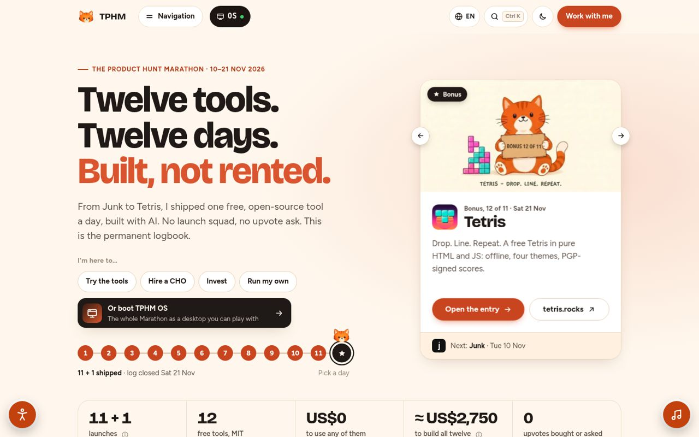
</picture>

<br>

[Logbook](https://tphm.io) · [Product Hunt chapter](https://tphm.io/hunt) · [Builders](https://tphm.io/builders) · [In simple words](https://tphm.io/simple) · [TPHM OS](https://tphm.io/os) · [Product Hunt](https://www.producthunt.com/@paulfxyz) · [Launch playbook](docs/LAUNCH-PLAYBOOK.md) · [Builders' kit](builders-kit/README.md)

</div>

<details>
<summary><strong>Contents</strong></summary>

- [The idea](#the-idea)
- [At a glance](#at-a-glance)
- [The twelve tools](#the-twelve-tools)
- [What's in this repo](#whats-in-this-repo)
- [Quick start](#quick-start)
- [How it was made](#how-it-was-made)
- [Six lessons](#six-lessons)
- [Learn from it](#learn-from-it)
- [Contributing](#contributing)
- [Licence](#licence)
- [Author](#author)

</details>

## The idea

From 10 to 21 November 2026 I shipped one free, open-source tool a day, built with AI: eleven launches, plus a twelfth for fun (a Tetris). Every one was launched manually on Product Hunt. There was no launch squad and no upvote ask, and I bought or asked for zero upvotes.

The rules I set myself were simple: one product a day, a clear page, a real maker comment, and an invitation to send feedback instead of votes. Every post on Product Hunt, X and LinkedIn was published by hand and logged in a small campaign manager.

This monorepo holds what was left behind once the run was over: the permanent logbook, the launch hub that ran during the campaign, and a cleaned snapshot of the manager. It is meant to be read and borrowed from as much as run. If you want to plan a run of public launches of your own, start with the [launch playbook](docs/LAUNCH-PLAYBOOK.md).

## At a glance

| | |
| --- | --- |
| **12** | free tools, all MIT-licensed, US$0 to use any of them |
| **11 + 1** | launches: eleven tools, plus the Tetris bonus |
| **12 days** | 10 to 21 November 2026 |
| **0** | upvotes bought or asked |
| **about US$2,204** | AI tokens, hours, other compute, marketing and hosting across all twelve. An estimate, not a price |
| **4 languages** | the logbook is built as 72 static pages in English, French, Mandarin and Hebrew |
| **3 folders** | the logbook, the first launch hub, and the social manager |

The budget figure is a rough total across every iteration. It is not what any single tool costs to run, and most of them run for a few dollars a month or free on your own machine. The real numbers (Product Hunt points for every launch, stars and what Paul learned) are in the Full Report, published on Thursday 26 November 2026 on [LinkedIn](https://www.linkedin.com/in/paulfxyz/) and [X](https://x.com/paulfxyz).

## The twelve tools

Each tool has its own repository and its own page in the logbook. Open the card for the story, the stack and what it took.

<table>
<tr>
<td width="33%" valign="top">
<a href="https://tphm.io/junk">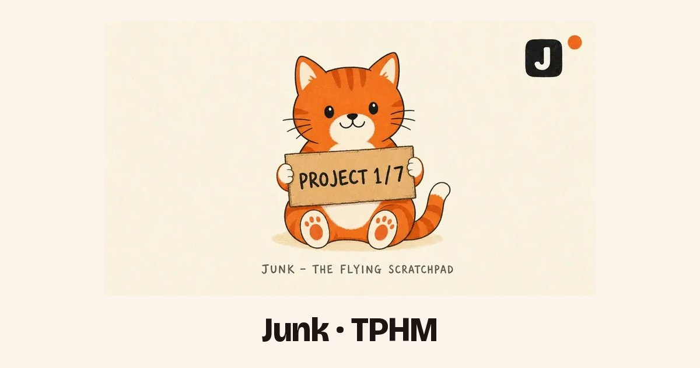</a><br>
<strong>Junk</strong><br>
A floating scratchpad for macOS, Windows and Linux (Cmd+J).<br>
<a href="https://tphm.io/junk">Page</a> · <a href="https://thejunk.app">Site</a> · <a href="https://github.com/paulfxyz/junk">Code</a>
</td>
<td width="33%" valign="top">
<a href="https://tphm.io/ase">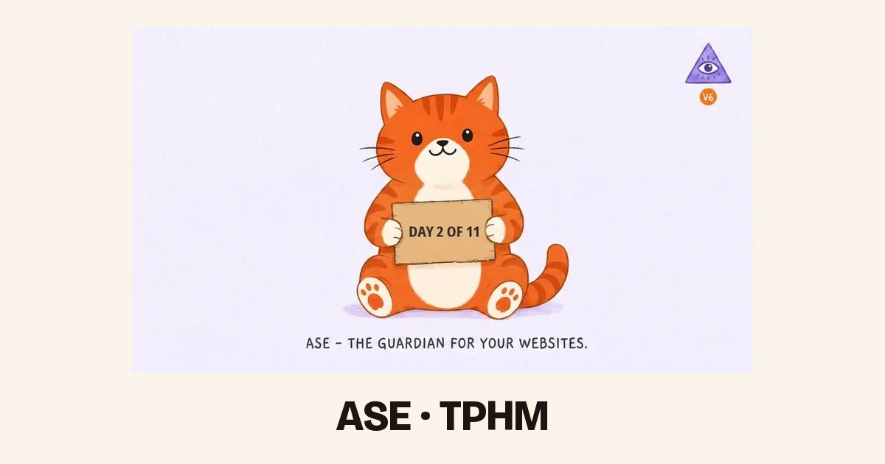</a><br>
<strong>ASE</strong><br>
Domain uptime monitoring with DNS and HTTP checks.<br>
<a href="https://tphm.io/ase">Page</a> · <a href="https://ase.so">Site</a> · <a href="https://github.com/paulfxyz/ase">Code</a>
</td>
<td width="33%" valign="top">
<a href="https://tphm.io/mang">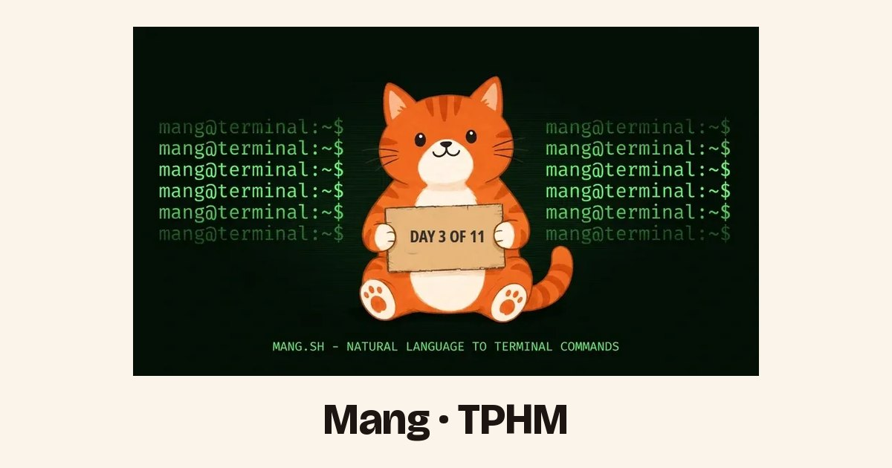</a><br>
<strong>Mang</strong><br>
A Rust terminal assistant that proposes shell commands you confirm.<br>
<a href="https://tphm.io/mang">Page</a> · <a href="https://mang.sh">Site</a> · <a href="https://github.com/paulfxyz/mang">Code</a>
</td>
</tr>
<tr>
<td width="33%" valign="top">
<a href="https://tphm.io/hollr">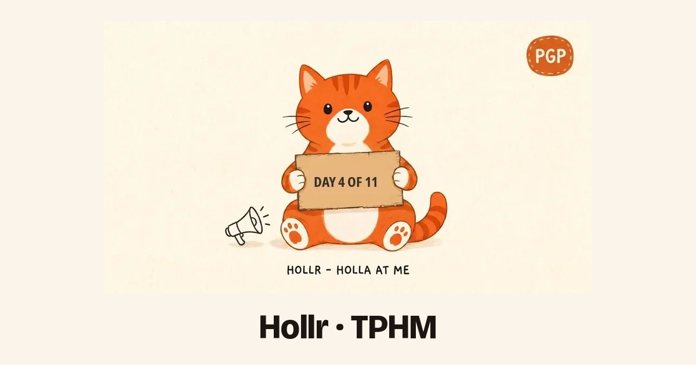</a><br>
<strong>Hollr</strong><br>
PGP-encrypted, timed messages.<br>
<a href="https://tphm.io/hollr">Page</a> · <a href="https://hollr.to">Site</a> · <a href="https://github.com/paulfxyz/hollr">Code</a>
</td>
<td width="33%" valign="top">
<a href="https://tphm.io/clippy">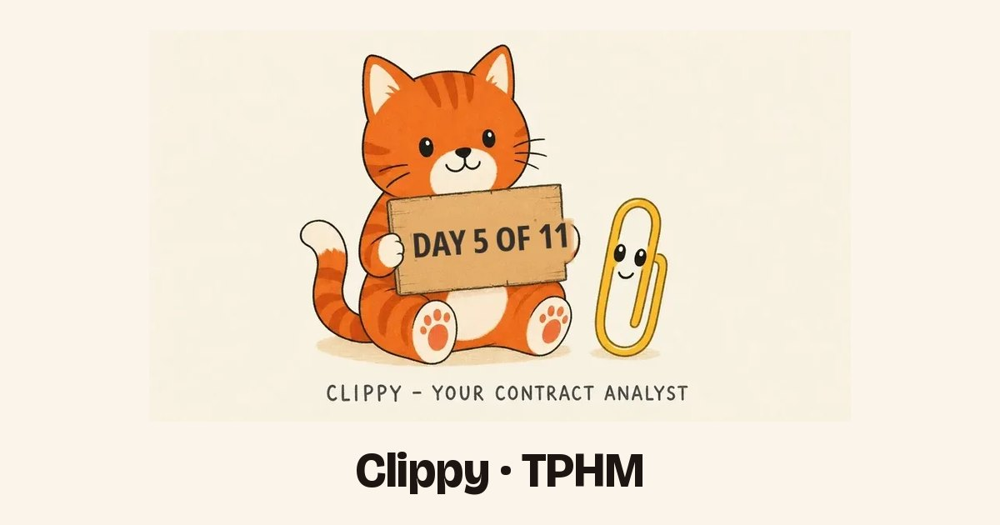</a><br>
<strong>Clippy</strong><br>
A contract analyst in 20 locales.<br>
<a href="https://tphm.io/clippy">Page</a> · <a href="https://clippy.legal">Site</a> · <a href="https://github.com/paulfxyz/clippy">Code</a>
</td>
<td width="33%" valign="top">
<a href="https://tphm.io/mercury">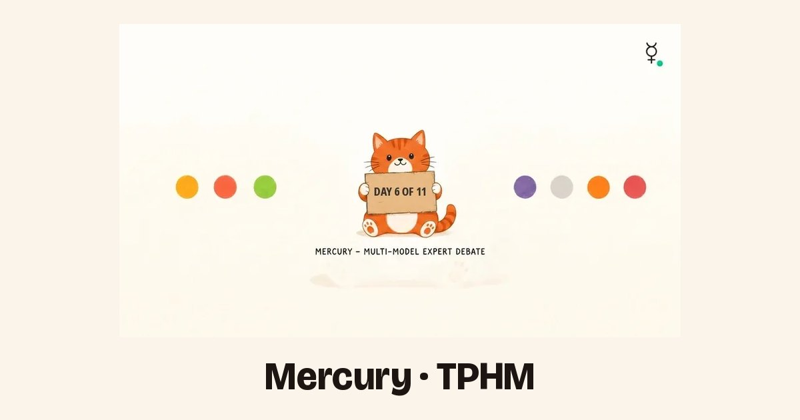</a><br>
<strong>Mercury</strong><br>
Multi-model research and debate.<br>
<a href="https://tphm.io/mercury">Page</a> · <a href="https://mercury.sh">Site</a> · <a href="https://github.com/paulfxyz/mercury">Code</a>
</td>
</tr>
<tr>
<td width="33%" valign="top">
<a href="https://tphm.io/megamesh">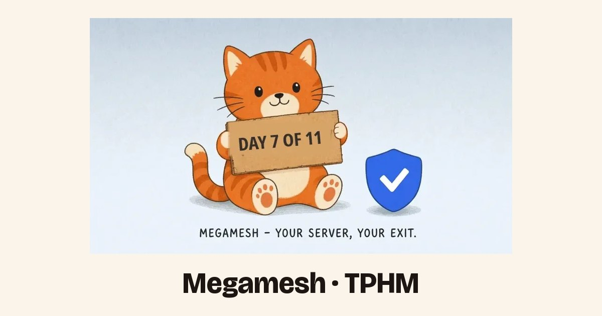</a><br>
<strong>Megamesh</strong><br>
Your own hardened WireGuard VPN.<br>
<a href="https://tphm.io/megamesh">Page</a> · <a href="https://megamesh.sh">Site</a> · <a href="https://github.com/paulfxyz/megamesh">Code</a>
</td>
<td width="33%" valign="top">
<a href="https://tphm.io/ai-credit-checker">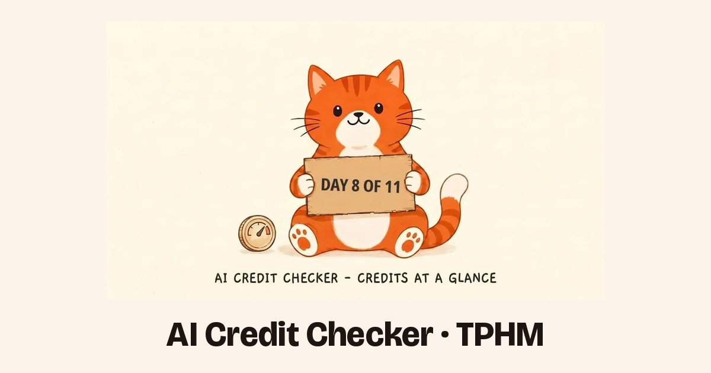</a><br>
<strong>AI Credit Checker</strong><br>
An AI credit balance monitor across providers.<br>
<a href="https://tphm.io/ai-credit-checker">Page</a> · <a href="https://github.com/paulfxyz/ai-credit-checker">Code</a>
</td>
<td width="33%" valign="top">
<a href="https://tphm.io/xnftables">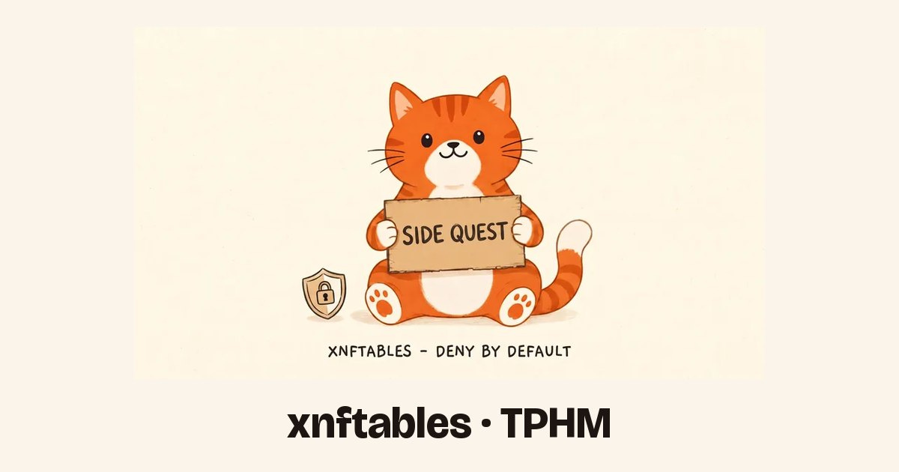</a><br>
<strong>xnftables</strong><br>
Deny-by-default nftables policies: mesh or nothing.<br>
<a href="https://tphm.io/xnftables">Page</a> · <a href="https://xnftables.net">Site</a> · <a href="https://github.com/paulfxyz/xnftables">Code</a>
</td>
</tr>
<tr>
<td width="33%" valign="top">
<a href="https://tphm.io/timescreen">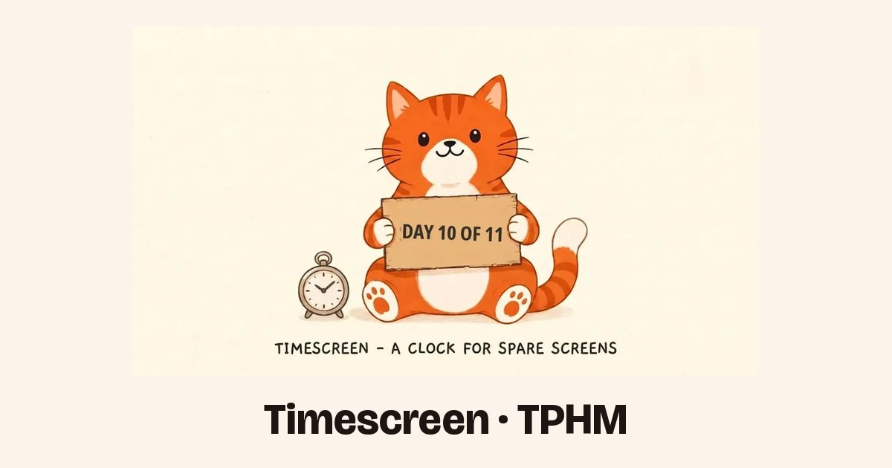</a><br>
<strong>Timescreen</strong><br>
A clock for a spare screen.<br>
<a href="https://tphm.io/timescreen">Page</a> · <a href="https://time.paulfleury.com">Site</a> · <a href="https://github.com/paulfxyz/timescreen">Code</a>
</td>
<td width="33%" valign="top">
<a href="https://tphm.io/mars">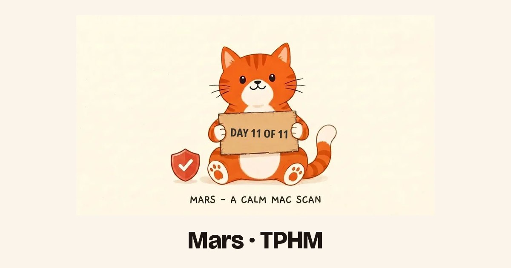</a><br>
<strong>Mars</strong><br>
A macOS malware scanner built around ClamAV.<br>
<a href="https://tphm.io/mars">Page</a> · <a href="https://github.com/paulfxyz/mars">Code</a>
</td>
<td width="33%" valign="top">
<a href="https://tetris.rocks">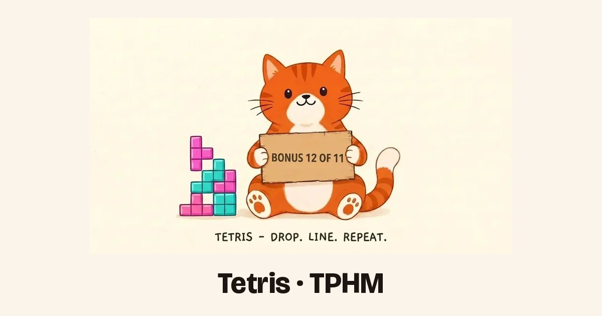</a><br>
<strong>Tetris</strong> (bonus)<br>
An offline HTML/JS Tetris with four themes, including Vice, and PGP-signed scores.<br>
<a href="https://tetris.rocks">Site</a> · <a href="https://github.com/paulfxyz/tetris">Code</a>
</td>
</tr>
</table>

Tetris has no page in the logbook because it is the bonus. Two tools, AI Credit Checker and Mars, have no separate website, so their logbook page is the best place to start. Tetris is a fan project and is not affiliated with The Tetris Company.

## What's in this repo

Three folders, each a different part of the campaign, plus a [builders' kit](builders-kit/README.md) of scripts you can reuse. Each has its own README with the detail.

<table>
<tr>
<td width="33%" valign="top">
<a href="tphm.io/README.md">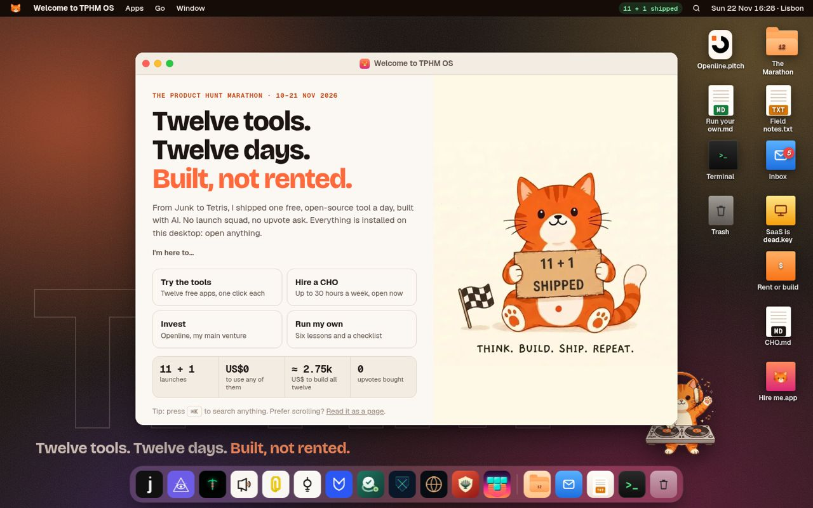</a><br>
<strong><a href="tphm.io/README.md">tphm.io/</a></strong><br>
The permanent logbook, with its full git history. Static HTML, CSS and vanilla JavaScript, with no framework and no bundler. It holds the twelve entries, the chapters (Product Hunt, SaaS is dead, Chief Hacking Officer, investors, builders, a plain-words page with narration) and TPHM OS, a fullscreen retro desktop you can play with.
</td>
<td width="33%" valign="top">
<a href="ph.paulfleury.com/README.md">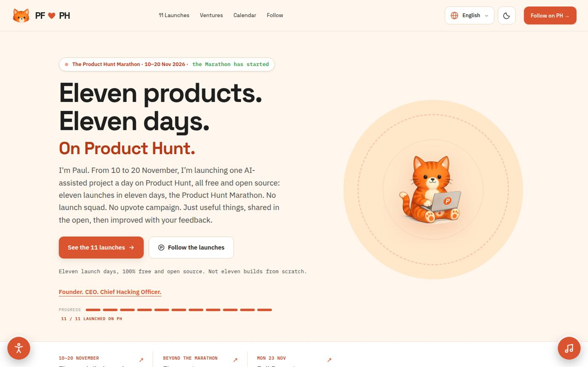</a><br>
<strong><a href="ph.paulfleury.com/README.md">ph.paulfleury.com/</a></strong><br>
The first launch hub, kept as an archive with its full history (91 commits). It ran during the campaign in ten languages, with a day-by-day launch carousel, a calendar and progress that unlocked each day at 08:00 Lisbon time. It now redirects to tphm.io.
</td>
<td width="33%" valign="top">
<a href="social-manager/README.md">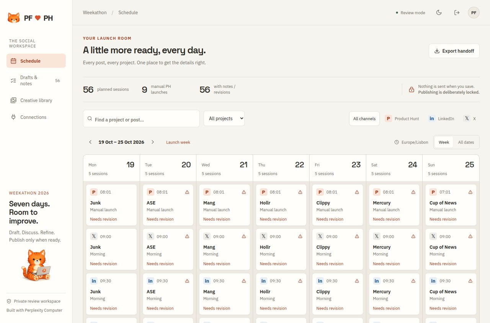</a><br>
<strong><a href="social-manager/README.md">social-manager/</a></strong><br>
PH Social Manager, as a cleaned, code-only snapshot. A weekly calendar of Product Hunt, X and LinkedIn slots, an editor, previews, readiness checks and manual posted receipts. It cannot publish or schedule anything: posting was done by hand.
</td>
</tr>
</table>

<details>
<summary><strong>Repo tree</strong></summary>

```text
product-hunt-marathon/
├── README.md
├── LICENSE                     MIT, for the code
├── CONTRIBUTING.md
├── docs/
│   ├── ARCHITECTURE.md
│   ├── LAUNCH-PLAYBOOK.md
│   ├── PRODUCT-HUNT-FIELD-NOTES.md
│   ├── BUILDING-WITH-AI.md
│   └── images/                 screenshots and the logo
├── builders-kit/               crosspost, shots, card, launch_calendar, motion, translate
│                               (Python, reusable for your own launches)
├── tphm.io/                    the logbook
│   ├── src/                    index.html, os.html, simple.json
│   ├── tools/                  build, harvest, translate, simple,
│   │                           simple_voice, og, serve (Python)
│   ├── assets/                 data.js, i18n/, og/
│   ├── os/                     TPHM OS (os.js, os.css)
│   ├── simple/                 plain-words page and narration
│   ├── app.js                  logbook behaviour
│   ├── ph.css, tphm.css        design system and additions
│   └── .htaccess               clean URLs and cache headers
├── ph.paulfleury.com/          the first launch hub (archive)
│   ├── archives/
│   ├── simple/
│   ├── tools/                  build, translate, SEO audit, OG scripts
│   └── calendar.ics, calendar.php
└── social-manager/             PH Social Manager (full code + example campaign)
    ├── client/                 React, Vite, TypeScript
    ├── server/                 Express API, SQLite store
    └── shared/                 schema, rules, follow-ups, media
```

</details>

## Quick start

Everything runs locally, and none of it needs credentials to read or browse.

**The logbook.** Serve it with the small local server, which mimics the clean URLs of the production `.htaccess` (so `/hunt` resolves to `hunt/index.html`):

```bash
cd tphm.io
python3 tools/serve.py 8931
# open http://127.0.0.1:8931
```

To rebuild the static pages after editing a template or the data:

```bash
python3 tools/build.py && python3 tools/simple.py
```

The translation steps are separate. `tools/harvest.py` uses Playwright to collect every English string, and `tools/translate.py` sends them through OpenRouter, so you need your own access there. Deployment is FTP over TLS to shared hosting, and credentials are never kept in the repo.

**The launch hub archive.** It is plain files. Serve the folder with anything static and open `archives/index.html`:

```bash
cd ph.paulfleury.com
python3 -m http.server
```

**The social manager.** From the `social-manager/` folder:

```bash
npm install
npm run dev      # tsx watch server/dev.ts
npm run build    # vite
npm run check    # tsc
npm test         # tsx --test
```

The snapshot has no real campaign data, no private assets and no deployment scripts, and only seven generic tests. An example campaign in `examples/` lets you run it locally. The owner address in the code is a placeholder. Sign-in is owner-only with a one-time password setup, so read the [folder README](social-manager/README.md) before pointing it at anything real.

## How it was made

The logbook is built the plain way. A template (`src/index.html`) holds the home page, the chapters and the dialogs. `tools/build.py` turns it into one static HTML file per page and language, 72 in all, each with its own URL, title, description, canonical link, hreflang tags and Open Graph tags. Because the output is plain files, it runs on ordinary shared hosting and is easy to read, view-source included.

Translation is a three-step loop. `harvest.py` clicks through every page and interactive state and collects each English string into `assets/i18n/keys.json`. `translate.py` sends those keys to French, Mandarin and Hebrew, with one model writing (`anthropic/claude-sonnet-5.5`) and a separate one reviewing (`google/gemini-3.8-flash`), and caches the results. `build.py --prerender` then bakes the translations into the HTML. The plain-words page has narration recorded with `google/gemini-3.8-flash-tts` (voice Achird).

AI was the pair-programmer and editor: Perplexity Computer orchestrating, with copy and translations routed through OpenRouter. I directed the work, reviewed it and took responsibility for it. Two habits kept that honest. Every database write had a backup, a dry run and a revision check, and production restarts needed my explicit approval. Commits are co-authored by Perplexity.

The full walk-through is in [docs/ARCHITECTURE.md](docs/ARCHITECTURE.md) and [docs/BUILDING-WITH-AI.md](docs/BUILDING-WITH-AI.md).

## Six lessons

These are the short versions. The [launch playbook](docs/LAUNCH-PLAYBOOK.md) has the reasoning, and the [builders page](https://tphm.io/builders) has a launch-day checklist you can tick off and copy.

1. **Build what you need yourself.** Every tool started as a small annoyance in my own week, so the copy and the bug reports were better for it.
2. **Lock one kit, then repeat it.** Day one set the template; check each new kit against the live product, because batches drift.
3. **Be honest about the build.** Say what AI did, what it cost and what the limits are.
4. **Ask for feedback, never votes.** Feedback improves the product, while votes fade by Friday.
5. **Publish by hand, keep receipts.** Post it yourself and log every link in one place, so things stay in sync when dates move.
6. **Make it accessible, in every language.** Reading aids, reduced motion, readable contrast and a simple page with narration cost little with AI and widen who can use your work.

## Learn from it

- [docs/ARCHITECTURE.md](docs/ARCHITECTURE.md): how the logbook, the hub and the manager fit together, and why they are built the way they are.
- [docs/LAUNCH-PLAYBOOK.md](docs/LAUNCH-PLAYBOOK.md): the six lessons in full, plus the launch-day kit.
- [docs/PRODUCT-HUNT-FIELD-NOTES.md](docs/PRODUCT-HUNT-FIELD-NOTES.md): my account as a long-time Product Hunt member. These are my own observations and not Product Hunt's documented policy.
- [docs/BUILDING-WITH-AI.md](docs/BUILDING-WITH-AI.md): how AI was used, what it cost and where the limits were.
- [builders-kit/](builders-kit/README.md): scripts to write each post once, size it for X, LinkedIn, Bluesky and Mastodon, keep receipts, take screenshots and GIFs, make cards, build a launch calendar, render animated covers to MP4 and GIF, and translate a site into many languages with a writer and a proofreader model.
- [CONTRIBUTING.md](CONTRIBUTING.md): how to report a problem or propose a change.

## Contributing

Issues and pull requests are welcome, and the order I work in is bugs first, then the smallest useful change. Read [CONTRIBUTING.md](CONTRIBUTING.md) before you start. Each of the twelve tools lives in its own repository, so please raise tool-specific issues there. This repo is for the logbook, the archive and the manager snapshot. To reach me directly, use [paulfleury.com/contact](https://paulfleury.com/contact).

## Licence

The code in this repository is released under the [MIT licence](LICENSE).

The written content, photos, the kitty illustrations and the narration audio are copyright Paul Fleury, all rights reserved unless stated otherwise. Product names belong to their owners. Product Hunt is a trademark of its owner, and this project is not affiliated with or endorsed by Product Hunt.

## Author

**Paul Fleury** is the founder of [Openline](https://openline.com), a travel eSIM company, and builds open-source tools on the side. He also offers consulting as a Chief Hacking Officer, described at [tphm.io/cho](https://tphm.io/cho).

[paulfleury.com](https://paulfleury.com) · [GitHub](https://github.com/paulfxyz) · [X](https://x.com/paulfxyz) · [LinkedIn](https://www.linkedin.com/in/paulfxyz/) · [Contact](https://paulfleury.com/contact)

<div align="center">

Think. Build. Ship. Repeat.

</div>
