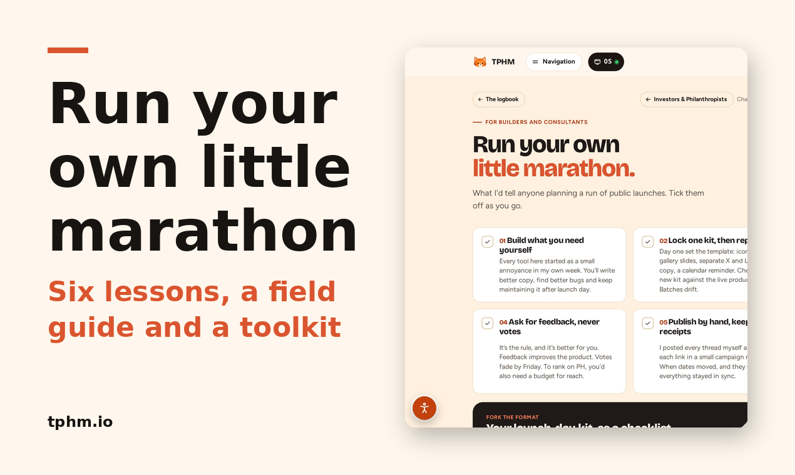
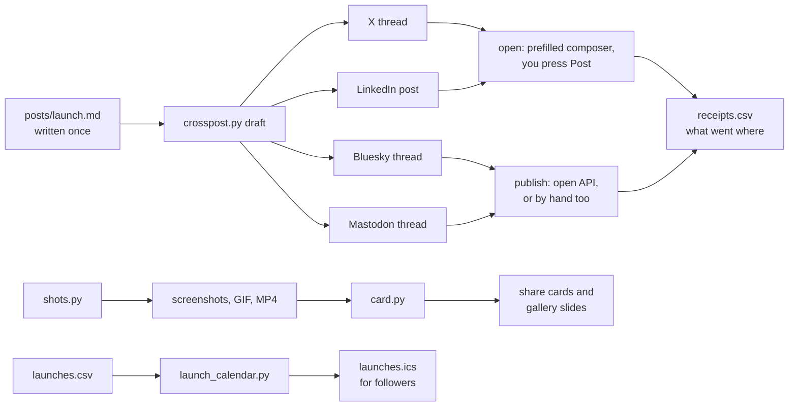

<div align="center">

# Builders' kit

**Small, readable tools for running your own launch marathon.**<br>
Write each post once, publish it everywhere by hand, keep receipts, and keep your gallery images honest.

[](#install)
[](#crosspostpy)
[](../LICENSE)



</div>

---

## Why this exists

The Marathon shipped twelve free tools in twelve days. Each one needed a Product Hunt page, an icon and gallery, separate copy for X and LinkedIn, a calendar reminder for followers, and a record of what was published where. I posted every thread myself; nothing went out on autopilot.

The parts that repeat every day are the ones worth automating: resizing a post for each platform, taking fresh screenshots after each fix, making cards that look like a series, and building one calendar file. Pressing Post stays a human job. These scripts are those repeating parts, cut down to something you can read in one sitting and change to suit you.

## The pipeline



## Install

```sh
git clone https://github.com/paulfxyz/product-hunt-marathon
cd product-hunt-marathon/builders-kit
pip install -r requirements.txt          # Pillow and Playwright
python3 -m playwright install chromium   # only needed for shots.py
```

`crosspost.py` and `launch_calendar.py` need nothing beyond Python itself.

## crosspost.py

Write one Markdown file per post. Common text first, and an optional `## x`, `## linkedin`, `## bluesky` or `## mastodon` section when a platform deserves its own wording. LinkedIn usually does: people read longer there, and lists work well.

```sh
python3 crosspost.py draft posts/example.md
#  x         2 post(s), longest 272/280
#  linkedin  1 post(s), longest 541/3000
#  bluesky   2 post(s), longest 268/300
#  mastodon  1 post(s), longest 486/500
```

What it handles for you:

- **Limits, counted the way each platform counts.** X and Mastodon count any link as 23 characters. X counts CJK characters and most emoji as two. Bluesky counts the link as written.
- **Threads that read well.** Text is cut on paragraphs first, then sentences, then words, never in the middle of a link, and numbered `1/3`, `2/3`.
- **Links that work on Bluesky.** Bluesky only makes a URL clickable if you send its position in bytes. The script does that.
- **Receipts.** Every draft and every published link goes into `receipts.csv`. Run `status` to see what went where.

Publishing, two ways:

```sh
python3 crosspost.py open posts/example.md x          # opens X's composer with the text in place
python3 crosspost.py receipt example x https://x.com/you/status/123

python3 crosspost.py publish posts/example.md bluesky,mastodon        # dry run
python3 crosspost.py publish posts/example.md bluesky,mastodon --yes  # sends, logs the link
```

`open` works for X, LinkedIn, Bluesky and Mastodon. It opens the platform's own posting screen with your text in place, and nothing is sent until you press the button. `publish` only covers Bluesky and Mastodon, which have free, open APIs. Use an app password for Bluesky and a token with the `write:statuses` scope for Mastodon, set as environment variables (see the top of the file).

## shots.py

```sh
python3 shots.py https://example.com --dark --mobile --full
python3 shots.py https://example.com --gif --hide ".cookie-banner"
python3 shots.py https://example.com --record 4 --click "#play"
```

Desktop (1440 x 900) and phone (390 x 844) screenshots at 2x, light and dark, viewport or full page. `--gif` makes a smooth scroll through the page (eased, with a pause at the end) as a GIF and, when ffmpeg is installed, an MP4 that is often ten times smaller. `--record` captures a few seconds of a page that moves by itself: a game, a chart, an animation.

Rerun it after every release. Your gallery should show what people will find when they click.

## card.py

```sh
python3 card.py "Junk" "A scratchpad, one shortcut away" --out junk-og.png
python3 card.py "Run your own little marathon" "Six lessons, a checklist and a toolkit" \
  --shot shots/example-com-desktop.jpg --size gallery --footer tphm.io
```

Sizes: `og` 1200 x 630 for link previews, `gallery` 1270 x 760 for Product Hunt slides, `x` 1600 x 900, `square` 1080 x 1080. The text colour is picked automatically for contrast. The title shrinks until it fits on three lines, and text never sits on top of the screenshot.

## launch_calendar.py

```sh
python3 launch_calendar.py launches.example.csv --out launches.ics --remind 15 --links
```

One `.ics` file for the whole run, which Apple Calendar, Google Calendar and Outlook all import, plus an "add to Google Calendar" link per launch for your posts. Write each time in the launch platform's own zone (Product Hunt days start at 00:01 Pacific) and let calendars convert it. Each event gets a stable ID, so if a date moves, re-importing the file moves the event instead of duplicating it.

## motion/: animated covers

The animated X and LinkedIn covers from the Marathon, as one HTML file. `cover.html` draws every frame from a single function, `render(t)`, so a scene is just a time window. `render.py` steps through it with Playwright and pipes the frames to ffmpeg.

```sh
cd motion
python3 render.py x --still 4,16.5   # check the layout on two frames first
python3 render.py x                  # 1600x900 -> out/x.mp4 and out/x.gif
python3 render.py li                 # 1080x1350 for LinkedIn
```

Change the numbers in the `P` array, the copy in each scene and the timings in `T`. It needs ffmpeg on your PATH.

## translate/: one site, many languages

The pipeline that translated tphm.io into 31 languages. One model writes each translation, a second proofreads it, and anything that damages a markup token is rejected instead of shipped. It only fills missing strings, so your hand fixes survive the next run.

```sh
cd translate
export OPENROUTER_API_KEY=...
python3 translate.py strings.example.json fr,de,ja,pt --context "A personal site for a solo builder."
```

Writing `<t0>bold</t0>`, `<t1/>` and `{0}` instead of raw HTML and values is what keeps the markup intact across scripts and right-to-left languages. Machine translation still benefits from a native speaker's read before you call it done.

## second-brain/: keep the AI bill small

A layout of plain Markdown notes your AI reads first, a [rules file](second-brain/RULES.md) for any AI tool, and `brain_kit.py`: it lists what's new since the last ingest, builds a context within a token budget, and lints links, the index and quotes against sources with zero tokens.

```bash
python3 second-brain/brain_kit.py init my-project
cd my-project && python3 ../second-brain/brain_kit.py changed
```

More in [second-brain/README.md](second-brain/README.md).

## The social manager

The campaign app I used to draft, review and log every post is in [`../social-manager`](../social-manager): the full client, server and shared code, plus an example campaign so you can run it locally in a few minutes. It plans and keeps receipts. It never posts for you.

## Guidelines that go with the code

1. **Automate the preparation, not the posting.** The scripts prepare, size and log. You still read each post one last time and press Post yourself.
2. **One idea per post, one idea per slide.** If it needs a second sentence, it needs a second slide.
3. **Say what AI did, what it cost, and what the tool doesn't do.** It earns more trust than a bigger claim.
4. **Ask for feedback, never votes.** It's the rule on Product Hunt, and feedback is what makes the next launch better.
5. **Keep images true.** Rerun `shots.py` after each fix, before you share anything.
6. **Keep receipts.** When a date moves, and it will, one file tells you what to update.
7. **Keep the AI bill small.** Give the model a second brain of notes it reads first, use the cheapest model that can do the job, and let scripts do the checks. The [second-brain kit](second-brain/README.md) packages all of it.

## Licence

MIT, like the rest of the code in this repository. Fork it, rename it, make it yours.
