# Architecture

This repository is a monorepo with three parts that were built for one project, The Product Hunt Marathon (10 to 21 November 2026). This document explains how each part works and why it was built that way, so you can change it or borrow from it.

| Part | What it is | Stack | Status |
| --- | --- | --- | --- |
| `tphm.io/` | The permanent logbook at https://tphm.io | Static HTML, CSS and vanilla JS, with Python build tools | Live |
| `ph.paulfleury.com/` | The first launch hub, used during the campaign | Static files, ten languages | Now a redirect to tphm.io, kept as an archive |
| `social-manager/` | PH Social Manager, a campaign calendar and copy editor | React, Vite, TypeScript, Express, SQLite | Cleaned, code-only snapshot |

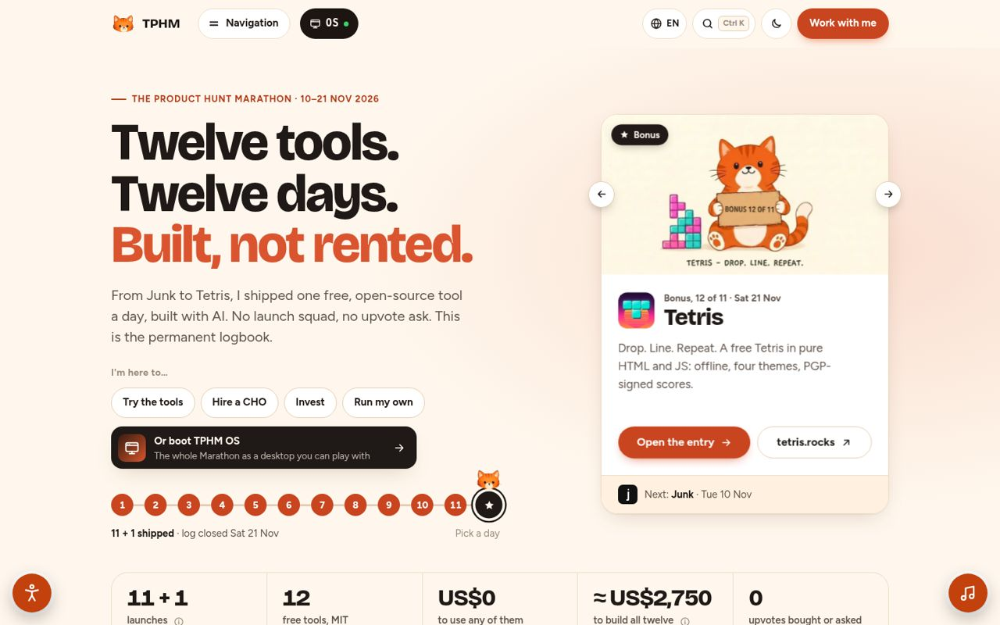

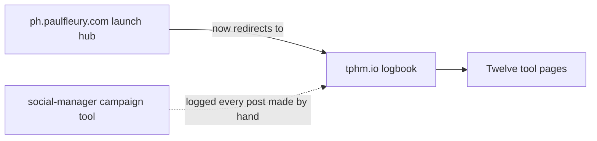

The dotted line is a workflow link, not a code link. The social manager has no code dependency on the logbook.

---

## 1. tphm.io: the logbook

The logbook is plain static HTML, CSS and vanilla JavaScript. There is no framework and no bundler. A handful of Python scripts in `tools/` generate the pages, translate them and produce the images.

### Layout

| Path | Purpose |
| --- | --- |
| `src/index.html` | Logbook template: the home page, the chapters (`data-page` sections) and the dialogs (`data-k` sections) |
| `src/os.html` | Template for TPHM OS |
| `src/simple.json` | Source for the plain-language page |
| `tools/build.py` | Writes one static HTML file per page and language |
| `tools/harvest.py` | Collects every English string into `assets/i18n/keys.json` |
| `tools/translate.py` | Translates `keys.json` into French, Mandarin and Hebrew |
| `tools/simple.py`, `tools/simple_voice.py` | Build the simple page and record its narration |
| `tools/og.py` | Draws the 1200x630 Open Graph cards |
| `tools/serve.py` | Local server that mimics the `.htaccess` clean URLs |
| `app.js` | Logbook behaviour: navigation, dialogs, tooltips, search, theme, the lessons checklist and the copyable launch kit |
| `assets/data.js` | `window.TPHM_LOG`, the twelve entries |
| `assets/i18n/i18n.js` | The runtime i18n layer |
| `os/` | TPHM OS, a fullscreen retro desktop (`os.js`, `os.css`) |
| `ph.css`, `tphm.css` | Shared design system (inherited from ph.paulfleury.com) and the additions for this site |
| `.htaccess` | Clean URLs and cache headers |

The chapters are `/hunt`, `/saas`, `/cho`, `/invest`, `/builders`, `/simple` and `/os`.

### The build pipeline

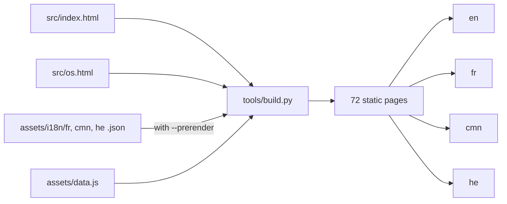

`build.py` takes the templates and writes one HTML file for every page in every language: four languages (`en`, `fr`, `cmn`, `he`), 72 pages in total. Each page gets its own:

- URL
- title and description
- canonical link
- hreflang alternates
- Open Graph tags

With `--prerender`, the translations from `assets/i18n/<code>.json` are baked into the HTML itself, so a translated page is complete before any JavaScript runs.

A constant called `VER` in `build.py` is the cache-busting version. Change it when you change CSS or JavaScript.

### Run it locally

```bash
cd tphm.io
python3 tools/serve.py 8931   # http://127.0.0.1:8931

# rebuild after editing a template or data
python3 tools/build.py && python3 tools/simple.py
```

`serve.py` exists because the production server rewrites clean URLs through `.htaccess` (for example `/hunt` to `hunt/index.html`). A plain `python3 -m http.server` would not do that, so links would break locally in ways they would not in production.

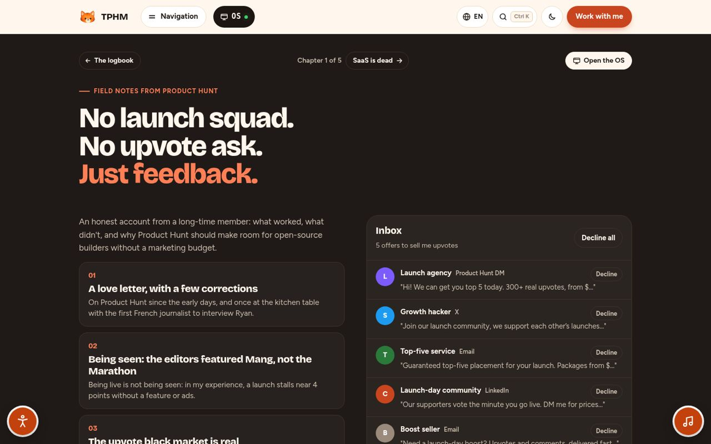

---

## 2. The i18n pipeline

Translation is a pipeline rather than a manual step, because every interactive state of the site contains text: dialogs, tooltips, search results, the checklist.

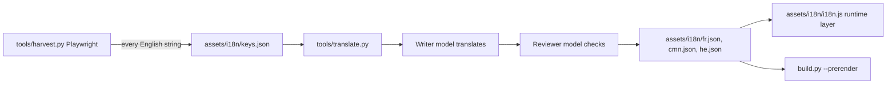

1. **Harvest.** `harvest.py` opens every page with Playwright and clicks through the interactive states, so strings that only appear after a click are still collected. The result is one English source of truth, `assets/i18n/keys.json`.
2. **Translate with a writer and a reviewer.** `translate.py` sends `keys.json` through OpenRouter. The writer is `anthropic/claude-sonnet-5.5`. A separate reviewer, `google/gemini-3.8-flash`, checks the writer's work. Using a different model for review means the checker does not share the writer's blind spots.
3. **Dictionaries.** The output is cached in `assets/i18n/<code>.json`, one file per language (`fr`, `cmn`, `he`).
4. **Two consumers.** `i18n.js` applies the dictionaries at runtime. `build.py --prerender` bakes the same dictionaries into the static HTML.

The design intent, as I read it: prerendered pages give each language a real URL with correct metadata, while the runtime layer covers text that only exists after interaction. Both read the same dictionaries, so they cannot disagree.

---

## 3. The simple page pipeline

The `/simple` page, "In simple words", is the plain-language version of the project with a narration player.

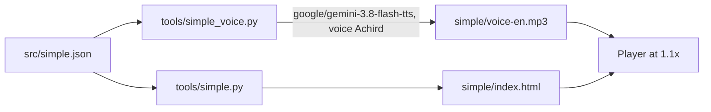

The copy lives in one JSON file. `simple.py` turns it into the page, and `simple_voice.py` records the narration from the same source, so text and audio are not edited separately. The player plays the audio at 1.1x.

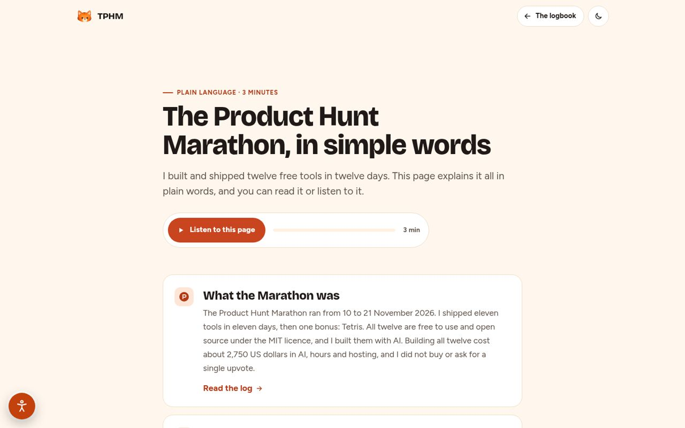

---

## 4. ph.paulfleury.com: the first launch hub

This was the campaign hub before tphm.io existed. It is kept here with its full history (91 commits) as an archive.

- Ten languages: en, fr, es, pt, ar, he, hi, bn, id, zh.
- A day-by-day launch carousel and a calendar (`calendar.ics`, `calendar.php`).
- Clock-driven progress that unlocked each day at 08:00 Lisbon time.
- `archives/` and a `simple/` page.
- Build, translate, SEO audit and OG scripts in `tools/`.

It is static and served as plain files. To browse the archive, run `python3 -m http.server` in that folder and open `archives/index.html`. The live site now redirects to tphm.io, and its design system lives on in `ph.css`.

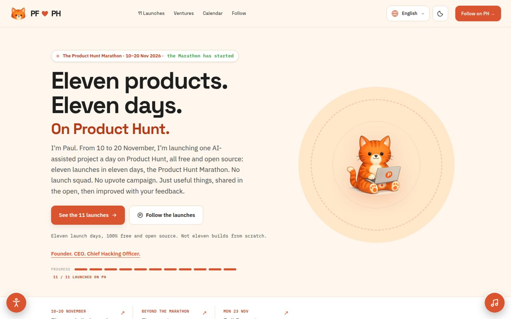

---

## 5. social-manager: PH Social Manager

A small tool for planning and logging the campaign: a weekly calendar of Product Hunt, X and LinkedIn slots, an editor, previews and receipts. It cannot publish or schedule anything. Every post was made by hand, and the manager recorded it.

This directory is a cleaned, code-only snapshot. It contains no campaign data, private assets, internal notes or deployment scripts, and only 7 generic tests. The owner email is the placeholder `owner@example.com` in `server/app.ts`, `server/fly-store.ts`, `server/migration.sql` and `client/main.tsx`; replace it with your own before running it.

| Area | Files |
| --- | --- |
| Client (React, Vite, TypeScript) | `client/main.tsx`, `PostPreview.tsx` (platform-style previews), `phKit.ts` |
| Server (Express) | `server/app.ts` (API), `dev.ts`, `production.ts`, `fly-store.ts` (SQLite on a Fly.io volume), `migration.sql` (legacy Supabase policies) |
| Shared | `shared/schema.ts`, `rules.ts` (copy rules and validation), `followup.ts` (numbered comment threads), `media.ts` |

Scripts: `npm run dev` (tsx watch on `server/dev.ts`), `npm run build` (Vite), `npm run check` (tsc), `npm test` (tsx --test).

### Request flow

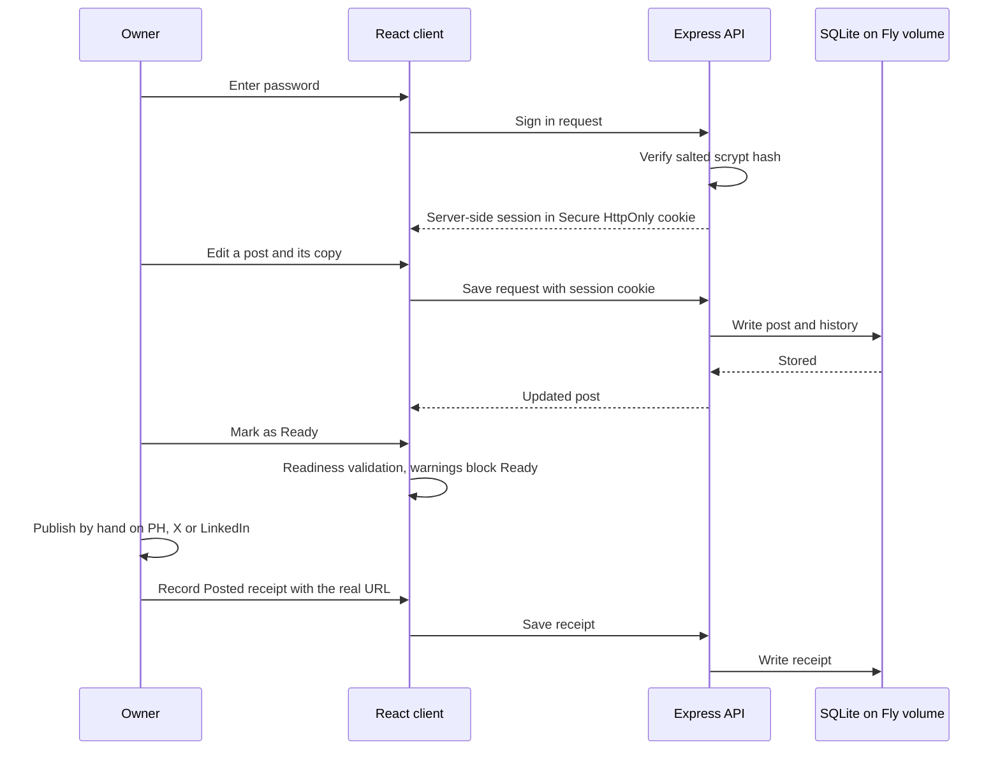

Some details that matter:

- **Owner-only access.** Sign-in is by password only, with salted scrypt hashing, server-side sessions and Secure, HttpOnly cookies. Password setup is a one-time step.
- **Rules live in `shared/`.** Copy rules and validation sit in `shared/rules.ts` rather than in the UI, so the client and server can both import them. Unresolved warnings block a post from being marked Ready.
- **Receipts are manual.** A Posted receipt is entered by the owner with the real URL, which is what keeps the log honest when dates move.
- **Handoff.** The manager can export a Markdown handoff.

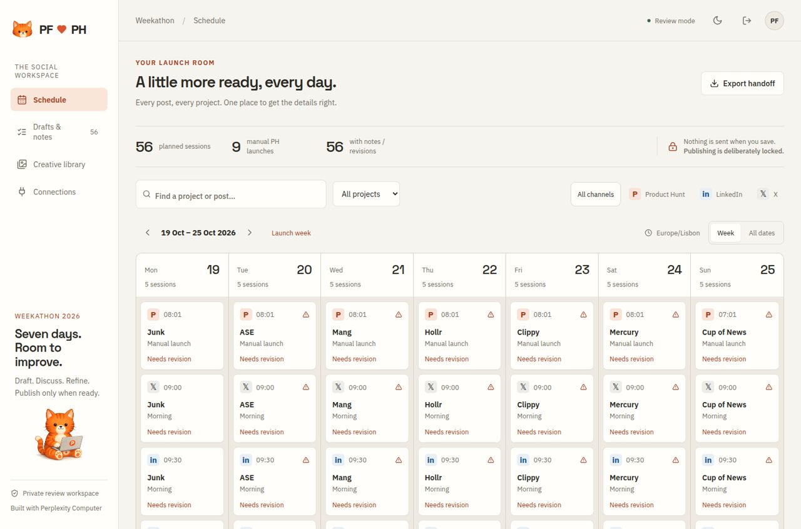

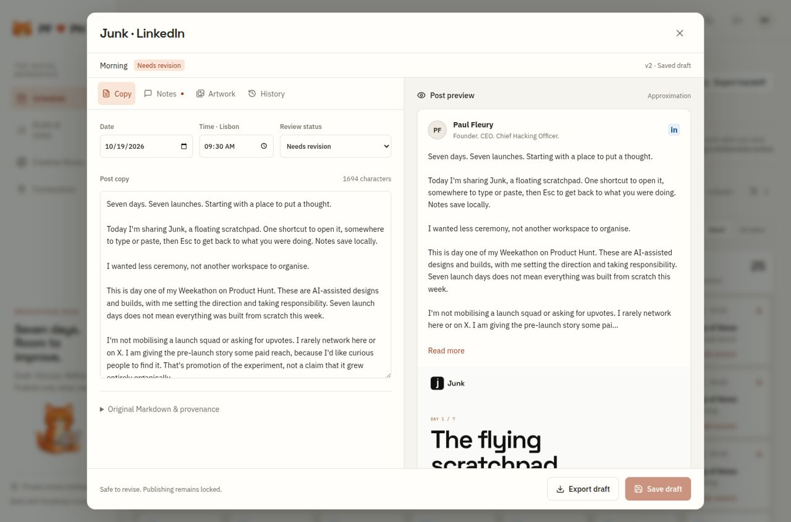

---

## Design decisions and trade-offs

**Static over frameworks.** The logbook is a record that should still open in ten years, and the tools it documents are meant to be runnable long after launch week. Plain HTML, CSS and JS with Python generators means there is nothing to upgrade and no dependency tree to audit. The cost is that you write more by hand: the templates repeat structure a framework would abstract, and every language multiplies the number of files.

**A build step, not a runtime.** `build.py` does at build time what a server framework would do per request. That keeps hosting simple (shared hosting, plain files). The trade-off is that nothing changes until you rebuild and redeploy.

**Clean URLs through `.htaccess`.** Pages are written as `folder/index.html` and `.htaccess` makes `/hunt` resolve to `hunt/index.html`. Links stay short and readable. The trade-off is a dependency on Apache-style rewrites, which is why `tools/serve.py` re-implements the rule locally.

**Cache-busting with `VER`.** `.htaccess` sets cache headers, and caching is only safe if changed files get new identities. One `VER` constant in `build.py` is easy to remember and easy to review. The trade-off is that it is global: bumping it invalidates everything, and forgetting to bump it means returning visitors may see stale CSS or JS.

**Per-language URLs with hreflang.** Each language is a separate, fully rendered page with its own canonical, title, description and hreflang tags, rather than one page that swaps text in the browser. Search engines and link previews then see the right language, and a link to a French page stays French. The cost is more files (72 pages) and a build that has to keep all of them consistent. The runtime `i18n.js` layer remains for interactive strings.

**Writer and reviewer for translation.** One model writes, a different one reviews. This is cheaper and faster than human review for four languages, but it is not a native speaker. Treat the output as reviewed by a model, and correct it if a native reader tells you otherwise.

**Harvest by clicking.** Collecting strings by driving a real browser catches text that a source scan would miss, at the cost of needing Playwright installed and the harvest script kept in step with new interactive states.

**Credentials stay out of the repo.** Deployment is FTP over TLS to shared hosting, and the credentials are never committed. The social manager snapshot likewise ships without deployment scripts.

**Accessibility is part of the build.** Reading aids, reduced motion, readable contrast and a simple page with narration are features of the site rather than an afterthought, and they apply in every language.

---

## How to extend it

The steps below follow the layout above. Where the exact variable or function name is not documented here, open the named script and look for where pages, languages or entries are listed.

### Add a page

1. In `src/index.html`, add a new section with a `data-page` attribute, following an existing chapter such as `/builders`.
2. Add a navigation link if it should appear in the menu.
3. Run `python3 tools/harvest.py` so the new strings land in `assets/i18n/keys.json`.
4. Run `python3 tools/translate.py` to update the `fr`, `cmn` and `he` dictionaries.
5. Run `python3 tools/build.py --prerender`, then bump `VER` if you changed CSS or JS.
6. Check the page in all four languages with `python3 tools/serve.py 8931`.

### Add a language

1. Add the language code where `build.py` lists its languages, and as a target in `tools/translate.py`.
2. Run the translator to create `assets/i18n/<code>.json`.
3. Make sure `i18n.js` knows about the new code and that the language switcher offers it.
4. For a right-to-left language, look at how Hebrew (`he`) is handled and follow the same approach.
5. Rebuild with `--prerender` and check titles, descriptions, canonical and hreflang on a few pages.
6. Have a fluent reader review it if you can. The reviewer model is a check, not a replacement.

### Add a tool

1. Add an entry to `window.TPHM_LOG` in `assets/data.js`, using the fields `n`, `day`, `name`, `key`, `kind`, `line`, `note`, `stack`, `budget`, `site`, `gh` and `ph`.
2. Add its dialog section (`data-k`) in `src/index.html`, following an existing tool.
3. Draw its card with `tools/og.py`, which writes a 1200x630 image to `assets/og/<repo>.jpg`.
4. Run harvest, translate and build as above. The tool's page then lives at `https://tphm.io/<repo>`.
5. Budgets are approximate totals of AI tokens, hours and hosting across every iteration, not prices, so label any new figure the same way.

A tool with no site of its own (AI Credit Checker and Mars are examples) simply has no `site` value, and the bonus Tetris has no page of its own because it lives at tetris.rocks.

---

## Licence and credit

Code is MIT licensed (see `LICENSE` at the root). Written content, photos, the kitty illustrations and the narration audio are (c) Paul Fleury, all rights reserved unless stated. Product names belong to their owners. Product Hunt is a trademark of its owner; this project is not affiliated with or endorsed by Product Hunt.

To contact the author, use https://paulfleury.com/contact.
