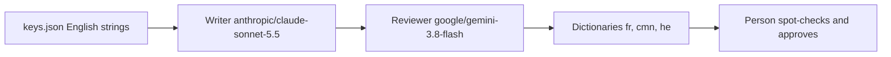
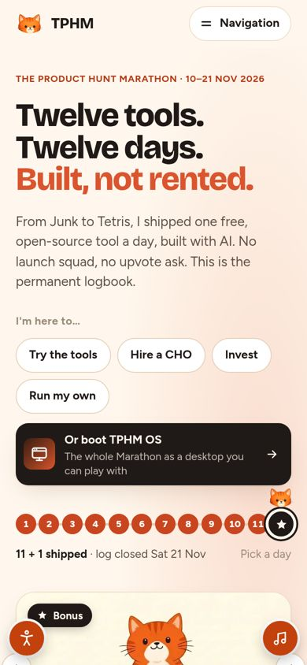

# Building with AI

This document describes how The Product Hunt Marathon was built with AI: who decided what, how models were split by job, what it cost, which safety rules applied and what to copy if you want to try something similar. It sticks to what was actually done and what the site says. It does not claim more than that.

## The short version

- AI was the pair-programmer and the editor. Paul Fleury directed the work, reviewed it and took responsibility for it.
- Perplexity Computer orchestrated the work. Copy and translations were routed through OpenRouter, with one model to write and a different model to review.
- Every database write had a backup, a dry run and a revision check. Production restarts needed explicit approval.
- Costs are given as honest estimates. The whole Marathon cost about US$2,204 across all twelve tools.
- Accessibility was built in, in every language.

## 1. Direction and responsibility stay with a person

The working split was simple. The AI proposed, wrote and revised. The person decided what to build, what to ship and what to say about it.

| Who | Does |
| --- | --- |
| Paul Fleury | Chooses what to build, directs, reviews, approves anything that touches production, publishes every post by hand and answers for the result |
| Perplexity Computer | Orchestrates the work as pair-programmer and editor; commits are co-authored by Perplexity |
| Writer model | Drafts copy and translations |
| Reviewer model | Checks the writer's output |

Two consequences follow from this:

1. **Disclose it.** The Marathon's own advice is to be honest about the build: say what AI did, what it cost and what the limits are. That is why commits carry the Perplexity co-author line and why the site states how it was made.
2. **Someone has to own it.** The site makes the same point about client work: every tool needs an owner, tests and a way back. The deliverable is a supported tool, not a chat transcript.

## 2. The writer and reviewer model split

For translation, the pipeline uses two different models through OpenRouter:

The reason for splitting the roles is that a model reviewing its own output tends to agree with itself. A second model, from a different provider, gives the check some independence. It is still a model. The last step in the diagram, a person looking at the result, is where responsibility sits.

The narration is produced the same way as the rest: scripted from a single source (`src/simple.json`) and recorded with `google/gemini-3.8-flash-tts` in the voice Achird. For the full pipeline see [ARCHITECTURE.md](ARCHITECTURE.md).

If you copy this approach:

- Keep one source of truth for text, then derive everything from it.
- Use a different model for review than for writing.
- Keep the dictionaries and prompts in the repository, so changes are visible in the history.
- Ask a fluent human to read at least a sample, particularly for languages the owner does not read.

## 3. Cost honesty

The numbers on the site are deliberately framed as estimates.

- Building all twelve tools cost about US$2,204. That figure covers AI tokens, hours, other compute, marketing and hosting across all twelve. It is an estimate, not a price.
- Each prototype took roughly US$20 to US$320 of AI and time.
- Most of the tools run for a few dollars a month, or free on your own machine.
- Budgets on the site are approximate totals across every iteration, not product prices or invoices.
- The consulting offer describes the same shape: a prototype in the low hundreds of dollars of AI, then hosting measured in dollars a month, with full lifetime costs estimated upfront.

Two habits are worth copying. First, count the whole life of a tool (iteration, AI usage, maintenance, security, expertise), not just the prototype. Second, say plainly that the figure is approximate.

## 4. Safety rules

Speed is the risk with AI-assisted work, so the rules slow down only the dangerous steps.

**Database writes**

1. Take a backup first.
2. Do a dry run and read what it would change.
3. Check the revision before writing, so you do not overwrite something that has moved on.

All three applied to every write.

**Production**

- Restarting production required explicit approval from the person, never from the AI alone.
- Deployment is FTP over TLS to shared hosting. Credentials are never in the repository.
- The public social manager snapshot is code only: no campaign data, no private assets, no internal notes and no deployment scripts. The owner address is a placeholder.

**Publishing**

- Every post on Product Hunt, X and LinkedIn was published by hand and logged in the social manager with its real URL.
- The social manager cannot publish or schedule at all. That is a deliberate boundary: the tool plans and records, a person posts.
- Readiness validation means unresolved warnings block a post from being marked Ready.

**Rules for yourself**

- Ask for feedback, never votes. 0 upvotes were bought or asked for.
- Decline every upvote offer.
- Do not let the assistant hold secrets. If a credential appears in a prompt or a file, assume it is exposed and rotate it.

## 5. Accessibility, in every language

The Marathon treats accessibility as part of the build, and the site says it costs little with AI and widens who can use your work. In practice that meant:

- Reading aids.
- Reduced motion support.
- Readable contrast.
- A simple page in plain words, with narration.

The point of the last lesson on the site is that these apply in every language you publish, not just English. When you add a language, check the same things again in it: contrast and layout still hold, right-to-left text reads properly, and the simple page exists. The narration recorded for this project is in English (`voice-en.mp3`); a new language would need its own recording.

## 6. What AI was good and bad at

The site text does not give a ranked verdict on where AI shone or failed, so this document does not invent one. What the text does say:

- Accessibility work costs little with AI.
- Batches drift. The lesson from running a repeatable launch kit is to check each new kit against the live product rather than trusting the template.
- Recreating software is not the same as rebuilding proprietary data, infrastructure, compliance or customer trust. That is a statement of belief and caution, not a benchmark.
- Predictable steps are better handled by ordinary code, with AI used where it earns its place and humans approving what matters.

If you want a fuller assessment, the Full Report (Tuesday 24 November 2026, on LinkedIn and X) is where the results are published.

## 7. A practical checklist

This is adapted from the launch-day kit on https://tphm.io/builders and from the safety rules above.

**Before you build**

- [ ] Pick something you need yourself. You will write better copy, find better bugs and keep maintaining it.
- [ ] Decide who owns each tool, who reviews AI output and who approves production changes.
- [ ] Put code in a public or organisation-owned repository, MIT or similar, with tests and a README.

**While you build**

- [ ] Keep one source of truth for copy and derive pages, translations and audio from it.
- [ ] Use a different model to review than to write.
- [ ] Lock one kit (icon, six gallery slides, separate X and LinkedIn copy, a calendar reminder), then check each new kit against the live product.
- [ ] Bugs first, then the smallest useful change.
- [ ] Write a clear page in plain language: what it does and what it does not.

**Before you touch production**

- [ ] Backup, dry run, revision check for every database write.
- [ ] Explicit human approval for restarts and deploys.
- [ ] No credentials in the repository.

**Accessibility**

- [ ] Reading aids, reduced motion, readable contrast.
- [ ] A simple page, with narration if you can.
- [ ] Repeat the checks in every language you publish.

**Launch and after**

- [ ] A real maker comment: what AI did, what it cost and the limits.
- [ ] Ask for feedback, never votes.
- [ ] Publish by hand and log each link in one place.
- [ ] Give cost figures as estimates and say so.

## Licence and credit

Code is MIT licensed. Written content, photos, the kitty illustrations and the narration audio are (c) Paul Fleury, all rights reserved unless stated. Product Hunt is a trademark of its owner; this project is not affiliated with or endorsed by Product Hunt.

To contact the author, use https://paulfleury.com/contact.
