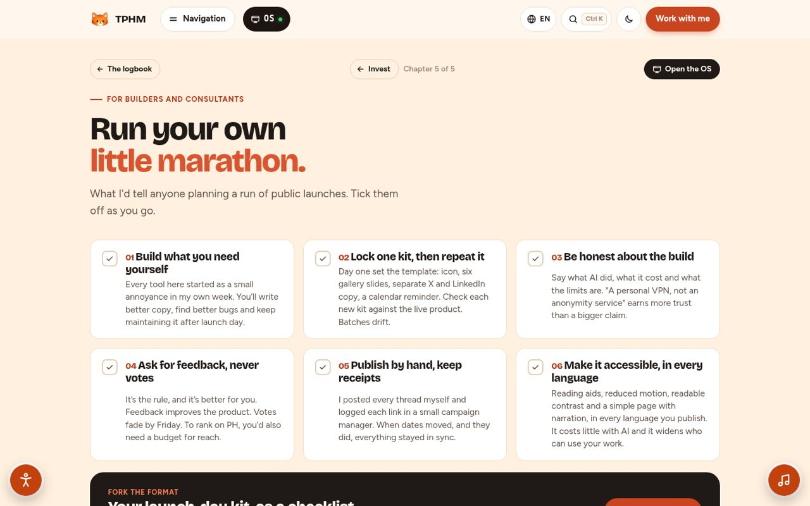

# Launch Playbook

This is the long version of the six lessons and the launch-day checklist on the [Builders chapter](https://tphm.io/builders) of the TPHM logbook. It is for anyone planning a run of public launches, whether that is one product or twelve.

The Marathon ran from 10 to 21 November 2026: one free, open-source (MIT) tool a day, built with AI, eleven launches plus a bonus (Tetris), each launched manually on Product Hunt. There was no launch squad and no upvote ask, and no upvotes were bought or asked for. Everything below comes from that run. It is one maker's experience, not a formula, so adapt it.



On the site the lessons are a tickable list, and your progress is kept in your browser's localStorage. Nothing leaves your machine.

## Contents

1. [The six lessons](#the-six-lessons)
2. [The launch-day kit](#the-launch-day-kit)
3. [A day-by-day routine](#a-day-by-day-routine)
4. [A post-launch routine](#a-post-launch-routine)
5. [Where to go next](#where-to-go-next)

---

## The six lessons

### 1. Build what you need yourself

> Every tool here started as a small annoyance in my own week. You'll write better copy, find better bugs and keep maintaining it after launch day.

**Why it matters.** A launch is a short event, and maintenance is the long part. If you are your own first user, three things get easier:

- You know what the product is for, so the copy stops being generic.
- You hit the bugs before anyone else does, because you use the thing in a real week.
- You have a reason to keep going once the launch page stops moving.

A tool built only to have something to launch tends to be abandoned the week after.

**How to do it.**

- Keep a running list of small annoyances from your own week. Pick the ones you would be happy to use daily.
- Before you build, write one sentence describing what the tool does and one describing what it does not do. If the second is hard to write, the scope is probably too wide.
- Ask yourself whether you will still be maintaining it in a month. If not, reconsider.

The twelve tools show the range: a floating scratchpad ([Junk](https://tphm.io/junk)), domain uptime monitoring ([ASE](https://tphm.io/ase)), a terminal assistant ([Mang](https://tphm.io/mang)), a clock for a spare screen ([Timescreen](https://tphm.io/timescreen)). All of them are small and specific.

### 2. Lock one kit, then repeat it

> Day one set the template: icon, six gallery slides, separate X and LinkedIn copy, a calendar reminder. Check each new kit against the live product. Batches drift.

**Why it matters.** When you ship something every day, decisions are your enemy. A fixed kit means you spend your energy on the product and not on re-deciding what a launch consists of. It also makes your work look consistent from one day to the next.

The warning is in the last sentence: batches drift. If you prepare several kits in a row, the screenshots, the feature list and the copy slowly stop matching what the product actually does. The product keeps changing while the kit stands still.

**How to do it.**

- Decide the kit once: one icon, six gallery slides, separate copy for X and for LinkedIn, and a calendar reminder for followers.
- Treat the first launch as the template and copy its structure exactly for the rest.
- Before each launch, open the live product beside the kit and check every claim and every slide against it.
- Put the check in your routine, not in your memory.

The social manager in this repository follows the same idea. It has a weekly calendar of Product Hunt, X and LinkedIn slots, an editor per post, and readiness validation in which unresolved warnings block a post from being marked Ready. The copy rules and validation live in `social-manager/shared/rules.ts`. You do not need that tool, but a checklist that blocks you is a good habit.

### 3. Be honest about the build

> Say what AI did, what it cost and what the limits are. “A personal VPN, not an anonymity service” earns more trust than a bigger claim.

**Why it matters.** AI-built software invites suspicion, and bigger claims make it worse. Readers trust a maker who says plainly what the thing is, what it is not and what it cost. The Megamesh line is the model: it describes your own hardened WireGuard VPN, and it says clearly that it is not an anonymity service. A narrower claim you can defend beats a broad one you cannot.

**How to do it.**

- Write a real maker comment, not a slogan. Cover what AI did, what it cost and where the limits are.
- Give a cost as an estimate and say that it is one. The Marathon's figure of about US$2,204 across all twelve tools covers AI tokens, hours, other compute, marketing and hosting, and the site calls it an estimate, not a price.
- State what the tool does not do on the page itself, in plain language.
- If you used AI for the build, say how you stayed in charge. In this project, Paul directed and reviewed, every database write had a backup, a dry run and a revision check, and production restarts needed explicit approval.

### 4. Ask for feedback, never votes

> It's the rule, and it's better for you. Feedback improves the product. Votes fade by Friday. To rank on PH, you'd also need a budget for reach.

**Why it matters.** Product Hunt's own guide says not to pay for upvotes or comments, and that bought engagement can get a launch removed and an account banned. Beyond the rules, the practical reason is that a vote does nothing for the product, while a sentence of feedback does. Votes also fade by the end of the week. A bug report or a feature request carries on being useful.

The second half is a plain observation, not a complaint: ranking well tends to need a budget for reach as well. Know that before you set your expectations. The full account is in the [field notes](PRODUCT-HUNT-FIELD-NOTES.md).

**How to do it.**

- End your maker comment with an invitation to send feedback, and nothing that asks for votes.
- Decline every offer to sell you upvotes, packages of supporters or placement guarantees. Say no each time, and do not negotiate.
- Decide in advance what a good launch looks like, and make it something other than a rank. Paul's answer was that twelve free tools now exist that did not a month earlier.
- Read Product Hunt's own guidance before you launch, and follow it.

### 5. Publish by hand, keep receipts

> I posted every thread myself and logged each link in a small campaign manager. When dates moved, and they did, everything stayed in sync.

**Why it matters.** Posting by hand keeps you present for each launch, and it keeps you out of any tool that could publish something wrong at the wrong moment. The receipts matter just as much. A twelve-day run produces dozens of posts across three platforms, and without a log you lose track of what went out, where and when. Dates will move, and a single source of truth stops the rest of the plan from falling apart.

**How to do it.**

- Pick one place for the whole plan: a spreadsheet, a notes file or a small tool.
- Record the real URL of every post once it is live, not a plan to post it.
- Keep the copy, notes and artwork for each post next to its receipt.
- When a date moves, change it in that one place.

The PH Social Manager in `social-manager/` is the version Paul built. It cannot publish or schedule, which was deliberate. It has a Posted receipt recorded manually with the real URL, per-platform approximate previews, numbered follow-up comment threads and a Markdown handoff export. The repository holds a cleaned, code-only snapshot with no campaign data.

### 6. Make it accessible, in every language

> Reading aids, reduced motion, readable contrast and a simple page with narration, in every language you publish. It costs little with AI and it widens who can use your work.

**Why it matters.** Accessibility is not a final polish step. Reading aids, reduced motion and readable contrast mean more people can use what you publish. A plain-language page with narration helps people who prefer to listen, people reading in a second language and anyone in a hurry.

**How to do it.**

- Build the basics in from the start: sensible contrast, a way to reduce motion, and reading aids.
- Write one page in plain words and add narration. On tphm.io that page is [/simple](https://tphm.io/simple). The page is generated from `src/simple.json`, and the narration is recorded by a script.
- Translate with a writer model and a separate reviewer model, and cache the output. The logbook is published in English, French, Mandarin and Hebrew, built into 72 static pages.
- Test each language, including right-to-left layout for Hebrew, as a real reader would.

The tools that do this are in `tphm.io/tools/`: `harvest.py` collects the English strings, `translate.py` translates them and `build.py` writes a static page per language.

---

## The launch-day kit

Copy this into your notes, your repo or your project tracker. It is the checklist from the Builders chapter, word for word.

```markdown
# My launch-day kit (adapted from The Product Hunt Marathon, tphm.io)
```

- [ ] One icon, six gallery slides, checked against the live product
- [ ] A clear page in plain language: what it does, what it doesn't
- [ ] A real maker comment: what AI did, what it cost, the limits
- [ ] Separate copy for X and LinkedIn, posted by hand
- [ ] A calendar reminder for followers
- [ ] Ask for feedback, never votes. Decline every upvote offer
- [ ] Log each published link in one place (receipts)
- [ ] Reading aids, reduced motion, readable contrast, a simple page
- [ ] Code public, MIT, with tests and a README
- [ ] Bugs first, then the smallest useful change

On the site, the Copy checklist button puts this list on your clipboard.

---

## A day-by-day routine

This routine is assembled from the site text and the lessons above. It is the shape of a launch day in the Marathon, not a minute-by-minute schedule, and Paul's own timings are not recorded here. Adapt the order to your own week.

### Before the run

1. Lock the kit once. Decide on the icon, the six gallery slides, the X copy, the LinkedIn copy and the calendar reminder.
2. Set your rules in writing. Paul's were: no launch squad, no upvote ask, no paid engagement on Product Hunt, just one product a day, a clear page, a real maker comment and an invitation to send feedback.
3. Set up one place to log receipts.
4. Build the plain-language page and the accessibility basics before the first day, not during it.

### Each launch day

1. **Check the kit against the live product.** Open the product, then the icon, the slides and the page. Fix whatever has drifted.
2. **Make sure the page says what the tool does and what it does not.** Use plain language.
3. **Write the maker comment.** Say what AI did, what it cost and the limits. End with an invitation to send feedback.
4. **Launch on Product Hunt by hand.**
5. **Post the X copy and the LinkedIn copy by hand.** They are separate, not one text pasted twice.
6. **Log every published link as a receipt** in your one place, as soon as the post is live.
7. **Set the calendar reminder** so followers know when the next one lands.
8. **Read feedback and reply.** Decline any offer of upvotes, packages or guaranteed placement. Do not engage with those.
9. **Note the bugs people report.** You will fix them first.

### If a date moves

Change it in the one place where the plan lives, then check that the calendar reminder and the copy still agree with it. The first campaign hub in this repository (`ph.paulfleury.com/`) used a clock-driven progress bar that unlocked each day at 08:00 Lisbon time, which shows how much depends on one date being right.

---

## A post-launch routine

The run is over when the log closes. The tools are not. The final line of the Builders chapter's checklist, bugs first and then the smallest useful change, is the whole routine in one sentence. In more detail:

1. **Read all the feedback.** Sort it into bugs and everything else.
2. **Fix bugs first.** A broken tool teaches people not to come back.
3. **Then make the smallest useful change.** Pick the one improvement that helps the most users for the least work, and ship it.
4. **Keep the code public, MIT, with tests and a README.** Anyone who finds the repository later should be able to run it and see what it does.
5. **Keep the receipts.** The log of links is now your record of what was published and when.
6. **Keep the permanent record.** The logbook at [tphm.io](https://tphm.io) was built to stay up after the run, with a page per tool and the story, stack and budget for each.
7. **Write the report.** The Full Report covers the Product Hunt points for every launch, stars and what Paul learned. It is published on Saturday 28 November 2026 on [LinkedIn](https://www.linkedin.com/in/paulfxyz/) and [X](https://x.com/paulfxyz). Count the results honestly, including the ones that disappoint you. Note that the paid boosts there were on X and LinkedIn, separate from the rule of no paid engagement on Product Hunt.
8. **Keep maintaining what you can.** This is where lesson one pays off, because you built something you use.

---

## Where to go next

- [Product Hunt field notes](PRODUCT-HUNT-FIELD-NOTES.md): the honest account of how the hunt went, and what to expect.
- [The Builders chapter](https://tphm.io/builders): the interactive lessons and checklist.
- [The logbook](https://tphm.io): all twelve tools, with the story, stack and budget for each.

The code in this repository is MIT licensed. The written content, photos, kitty illustrations and narration audio are copyright Paul Fleury, all rights reserved unless stated. Product Hunt is a trademark of its owner, and this project is not affiliated with or endorsed by Product Hunt.
