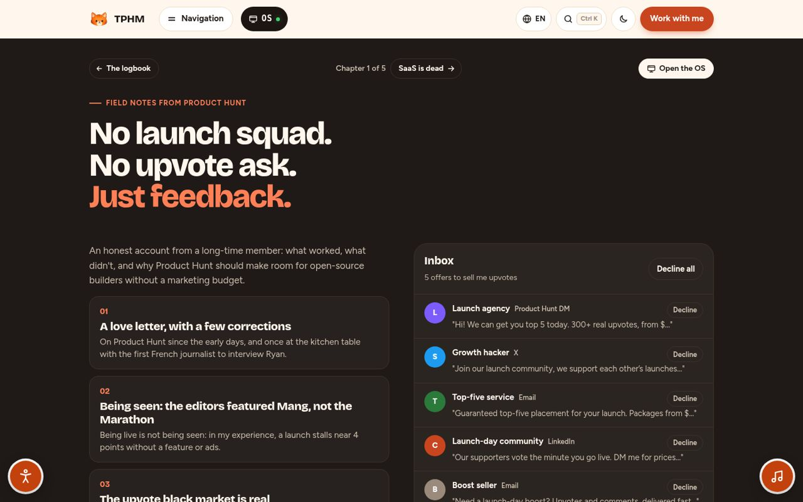

# Product Hunt Field Notes

These are Paul Fleury's field notes from the Product Hunt chapter of the Marathon logbook, kept as a document you can read in the repository. The live version is at [tphm.io/hunt](https://tphm.io/hunt).

A note on what this is. Everything here is one maker's experience over twelve launches between 10 and 21 November 2026. Where the notes describe how Product Hunt behaves, that is Paul's own observation as a long-time member, not Product Hunt's documented policy. Where the notes describe Product Hunt's rules, they link to Product Hunt's own help pages.

The short version: no launch squad, no upvote ask, just feedback. An honest account from a long-time member of what worked, what did not, and why Product Hunt should make room for open-source builders without a marketing budget.

## Contents

1. [A love letter, with a few corrections](#1-a-love-letter-with-a-few-corrections)
2. [Being seen: the editors featured Mang, not the Marathon](#2-being-seen-the-editors-featured-mang-not-the-marathon)
3. [The upvote black market is real](#3-the-upvote-black-market-is-real)
4. [What I would change, and would I do it again?](#4-what-i-would-change-and-would-i-do-it-again)
5. [Practical advice for open-source makers considering Product Hunt](#5-practical-advice-for-open-source-makers-considering-product-hunt)

---

## 1. A love letter, with a few corrections

Paul has been on Product Hunt since its early days. Back then he was in a relationship with the first French journalist to interview Ryan Hoover, so he likes to think he heard about it at the kitchen table before most of France did. He has browsed it, hunted on it and recommended it for a decade.

The Marathon was his way of giving something back: eleven useful, free tools in a row, plus one for fun.

That context matters for how to read the rest. These notes are written with affection and the criticism is meant constructively.

### The rules he set for himself

- No launch squad.
- No upvote ask.
- No paid engagement.
- Just one product a day, a clear page, a real maker comment and an invitation to send feedback.

In total, zero upvotes were bought or asked for.

---

## 2. Being seen: the editors featured Mang, not the Marathon

### Being live is not being seen

On Product Hunt, being live and being seen are two different things.

Every launch gets a page, but the team hand-picks which ones appear on the [homepage](https://help.producthunt.com/en/articles/17734306-1-how-product-hunt-works). Featuring is an editorial decision that meeting the guidelines does not guarantee, as the [launch FAQ and myths](https://help.producthunt.com/en/articles/17734646-8-launch-faq-and-myths) page explains. Launches that are not featured sit behind a “See all of today's products” link that most visitors never click.

### Mang was featured

The editors did pick up [Mang](https://tphm.io/mang), the terminal assistant from day three ([mang.sh](https://mang.sh)), and featured it. Paul calls that a real moment.

But the Marathon as a whole never became the story. Eleven consecutive free, MIT-licensed launches from one maker read as eleven separate small products, each judged on its own day. Others, [Megamesh](https://tphm.io/megamesh) for one, may well have deserved attention too.

Paul does not think anyone acted in bad faith. What it shows is what the curation model rewards: one big, polished, funded launch beats a steady run of honest small ones.

### The roughly 4-point cap (an observation, not policy)

Here is what Paul has observed as a long-time member, and not Product Hunt's documented policy:

- In practice, a product seems to be capped at about 4 upvote points unless it brings a large volume of votes.
- The exceptions he saw were a product that gets featured editorially, or one that runs an ad campaign on Product Hunt.
- That campaign costs about US$55 CPM, which is expensive for an indie maker.

Treat that as a single maker's reading of the pattern. If you are planning around it, check the current situation yourself.

### What the guidelines say

Product Hunt's [featuring guidelines](https://help.producthunt.com/en/articles/17734341-2-what-kind-of-products-get-featured) look for originality, a clear edge, plain language and a product that works. Upvotes alone do not decide it.

---

## 3. The upvote black market is real

From the first launch day, Paul's inbox filled with offers to sell him upvotes:

- Packages of “supporters”.
- Guaranteed top-five placements.
- Launch-day “communities” that vote on command.

He did not keep count, but there were a lot of them, on Product Hunt, LinkedIn, X and email. On the logbook, a small inbox widget shows five paraphrased examples with a Decline all button. They are paraphrased from the kind of offers he received, and he declined every one.

### What Product Hunt says

Product Hunt is clear that this is against the rules.

- Its own guide says [never pay for upvotes or comments](https://help.producthunt.com/en/articles/17734384-5-how-to-promote-your-launch-and-what-to-avoid), and that bought engagement can get a launch removed and an account banned.
- It also weights votes by account history, so votes from brand-new or low-quality accounts earn [far fewer points](https://help.producthunt.com/en/articles/17734646-8-launch-faq-and-myths).

Paul's reaction is that this is good. But a market only exists when buyers exist, and the volume of offers tells you that many makers are paying.

### The leaderboard problem

Too often, the leaderboard rewards whoever can manufacture momentum: a commercial launch with a paid push, a “community” of vote-swappers, or a pump-and-dump product that collects a badge and disappears within a year. Meanwhile, free tools with their code on GitHub, the kind you can still run in ten years, get a fraction of the attention.

That is not a complaint about the people who work there. It is a design problem. When attention is ranked by votes, votes become a currency, and currencies get counterfeited.

---

## 4. What I would change, and would I do it again?

### What he would change

Paul would love Product Hunt to update its algorithm so that open-source software is fairly unlocked and put forward, without needing a marketing budget of any kind: no upvote push, and no ad campaign on Product Hunt. A lane for open-source launches, or credit for makers who ship consistently and honestly, would be a good start.

His takeaway, as a long-time member: if you want to perform on Product Hunt today, you need a big marketing budget alongside your launch. He thinks the platform is no longer suited to indie makers as it is, but that it could make room for open-source builders.

> “Open-source, free work deserves at least the attention we give to commercial launches with a paid push behind them.”
>
> Paul Fleury, field notes

### Would he do it again?

Yes.

The point was never the leaderboard. Twelve tools now exist that did not a month ago, and every one of them is free.

### The Full Report

The full numbers, covering visits, stars, feedback and what the paid boosts on X and LinkedIn actually delivered, are in the Full Report. It is published on Tuesday 24 November 2026 on [LinkedIn](https://www.linkedin.com/in/paulfxyz/) and [X](https://x.com/paulfxyz).

---

## 5. Practical advice for open-source makers considering Product Hunt

This section is a set of suggestions that follow from the notes above. It is not an official guide and not a guarantee. Paul's answer was yes, and yours might be too, but go in with clear eyes.

**Decide what success means before you launch.** If the goal is a rank, the notes suggest you may be disappointed without volume, an editorial feature or ads. If the goal is to get a tool in front of some people, collect feedback and leave a public record, a quiet launch can still do that. Paul's measure was that twelve free tools now exist.

**Understand the difference between live and seen.** A page is not the same as exposure. Do not assume that a launch being live means anyone is looking at it. Plan where else your audience will find you.

**Have somewhere permanent to point people.** The Marathon's logbook at [tphm.io](https://tphm.io) exists because a launch page does not last. Give your project its own page, with the story, the stack, the licence and the repository.

**Read Product Hunt's own guidance first.** The four help pages linked above cover how the platform works, what gets featured, what to avoid and the launch FAQ. Follow them.

**Write for plain-language clarity.** The featuring guidelines look for a clear edge and plain language. Say what the tool does and what it does not. Make sure the product works on the day.

**Ask for feedback, not votes, and say no to every offer.** You will probably receive offers to buy upvotes, guaranteed placement or community voting. Decline them. They are against Product Hunt's rules and can get a launch removed and an account banned. Ask for feedback instead, because it improves the product.

**Do not expect a series to be read as a series.** In Paul's experience, eleven consecutive launches were each judged as separate products on their own day. If you launch several tools, give each one its own clear page and its own reason to exist.

**Be realistic about the budget question.** Paul's view is that performing on Product Hunt today takes a big marketing budget alongside the launch, and that ads cost about US$55 CPM. That is his observation, not a published figure from Product Hunt. If you have no budget, plan on that basis and measure by feedback.

**Keep your own record.** Log every post you publish, with its real link, in one place. The [Launch Playbook](LAUNCH-PLAYBOOK.md) describes how.

**Publish the honest numbers afterwards.** Paul's Full Report is meant to include what worked, including the paid boosts on X and LinkedIn and what they actually delivered. Other open-source makers will get more from your real figures than from a highlight reel.

---

## Licence and notices

The code in this repository is MIT licensed. The written content, photos, kitty illustrations and narration audio are copyright Paul Fleury, all rights reserved unless stated. Product Hunt is a trademark of its owner. This project is not affiliated with or endorsed by Product Hunt.

For contact, use [paulfleury.com/contact](https://paulfleury.com/contact).
