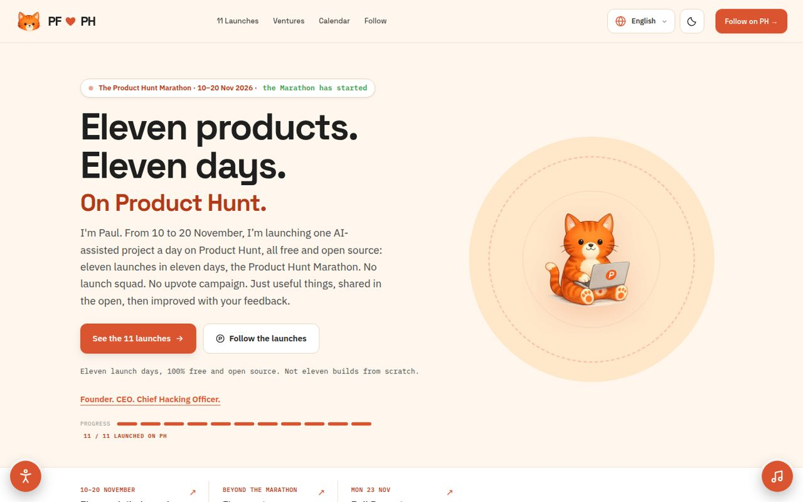

# ph.paulfleury.com: the first launch hub

This folder holds the first launch hub of The Product Hunt Marathon, kept as a record. The address `ph.paulfleury.com` now redirects to [tphm.io](https://tphm.io), the permanent logbook. This README explains what the hub was, how it worked, why it was retired, and how to look at any earlier version of it.



## What it was

The Marathon ran from 10 to 21 November 2026: one free, open-source (MIT) tool a day, built with AI, eleven launches plus a bonus (Tetris), each launched manually on Product Hunt. This site was the first public home for that campaign, built while it was being planned and run.

It was a static site, served as plain files, with:

- A day-by-day launch carousel, one card per tool.
- A calendar, offered as `calendar.ics` for your own calendar app and `calendar.php`.
- Clock-driven progress that unlocked each day at 08:00 Lisbon time (more on that below).
- An `archives/` section.
- A `simple/` page, written in plain words.
- Ten languages.
- A `tools/` folder with the build and translation scripts used for the marathon, plus an SEO audit and Open Graph card scripts.

The history of this folder is preserved in full in the monorepo: 91 commits.

## File tree

This is a guide to the parts worth knowing about, not a complete listing. Browse the folder itself for everything else.

```text
ph.paulfleury.com/
  README.md          this file
  calendar.ics       the launch calendar as a plain calendar file
  calendar.php       the calendar served through PHP
  archives/
    index.html       entry point for the archives section
  simple/            the plain-language page
  tools/             marathon build and translate scripts,
                     SEO audit and Open Graph scripts
```

The site files that make up the carousel and the ten languages sit alongside these. Today the folder is mostly the redirect, so the full site is found in git history (see below).

## Ten languages

The hub was published in ten languages:

| Code | Language |
| --- | --- |
| en | English |
| fr | French |
| es | Spanish |
| pt | Portuguese |
| ar | Arabic |
| he | Hebrew |
| hi | Hindi |
| bn | Bengali |
| id | Indonesian |
| zh | Chinese |

Two of these, Arabic and Hebrew, read right to left, so layout has to mirror rather than merely swap the words. The guiding rule was that every language is complete: a language is either fully there or it is not shipped. The marathon build and translation scripts in `tools/` were used to produce them, with copy and translations routed through a writer model and a separate reviewer model.

The successor logbook at tphm.io is smaller in this respect: it is published in English, French, Mandarin Chinese and Hebrew.

## The clock-driven daily unlock

A launch campaign has a problem that an ordinary website does not: the content has to appear on a schedule, and the schedule is part of the story. Each launch day opened at 08:00 Lisbon time.

The hub tied that to the clock. Progress through the marathon was derived from the current time, so a day's card became available when its moment arrived, rather than someone publishing it by hand at the right minute. The practical benefits of this design are worth noting:

- There is nothing to forget to do on launch morning.
- A visitor arriving on day four sees days one to four unlocked and the rest waiting, without any server remembering where the campaign is up to.
- It suits a site served as plain static files, because the page does the work itself.

If you want the exact mechanics, read the source from the commit history (instructions below) rather than relying on this summary. The code is the authority.

The launches themselves were never automated. Every post on Product Hunt, X and LinkedIn was published by hand and logged in the social manager, which also could not publish or schedule anything. The clock only controlled what the hub showed.

## Why it now redirects

The hub was built as a launch-time site. Once the campaign was over, a permanent and maintained home made more sense than leaving two overlapping sites online. [tphm.io](https://tphm.io) is that home: the logbook with a page for each tool, the field notes, the lessons for builders, a plain-language page with narration, and TPHM OS.

Redirecting the old address means existing links still land somewhere useful instead of on a page that no longer reflects the finished story. The design system was not lost either: the logbook's shared stylesheet, `ph.css`, is inherited from this site.

Nothing was deleted. The monorepo keeps the whole history of this folder.

## Browsing old versions

Because this folder has its own history inside the monorepo, you can look at it as it was at any commit.

1. List the commits that touched this folder:

   ```bash
   git log --oneline -- ph.paulfleury.com
   ```

   Add `--stat` if you want to see which files each commit changed.

2. Pick a commit hash from the list and check it out:

   ```bash
   git checkout <commit>
   ```

   Git will tell you that you are in a detached HEAD state. That is expected for looking around. Make no commits there unless you first create a branch with `git switch -c my-branch`.

3. Serve the folder as plain files and open it in your browser:

   ```bash
   cd ph.paulfleury.com
   python3 -m http.server
   ```

   Then open `archives/index.html` (or the site's entry page) through that local address. Opening files straight from disk can break relative paths, which is why a small static server is better. A `.php` file needs a PHP-capable server, so `calendar.php` will not behave as it did in production under a plain static server, whereas `calendar.ics` is an ordinary file.

4. When you have finished, return to where you started:

   ```bash
   git switch -
   ```

If you would rather not move the whole repository, you can restore only this folder from an older commit into your working tree, and discard it afterwards:

```bash
git checkout <commit> -- ph.paulfleury.com
```

Use `git restore --source=HEAD --staged --worktree -- ph.paulfleury.com` to put it back as it is now.

## Related

- The current logbook: [tphm.io](https://tphm.io)
- The whole project: [github.com/paulfxyz/product-hunt-marathon](https://github.com/paulfxyz/product-hunt-marathon)
- Contributing: see [CONTRIBUTING.md](../CONTRIBUTING.md)

## Licence

Code is MIT licensed (see the `LICENSE` file at the repository root). Written content, photos, the kitty illustrations and the narration audio are (c) Paul Fleury, all rights reserved unless stated. Product names belong to their owners. Product Hunt is a trademark of its owner; this project is not affiliated with or endorsed by Product Hunt.

Built by [Paul Fleury](https://paulfleury.com), with AI as pair-programmer and editor and Paul directing, reviewing and taking responsibility. To get in touch, use https://paulfleury.com/contact.
