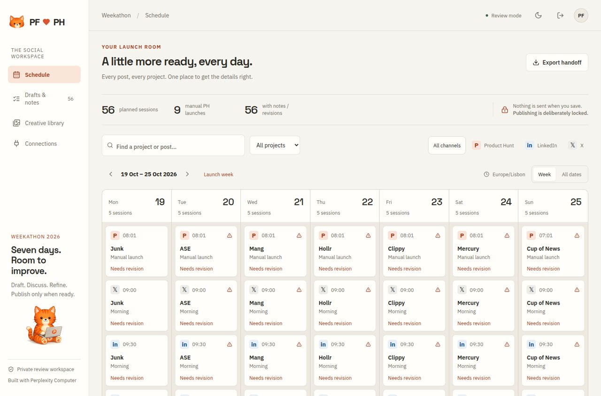
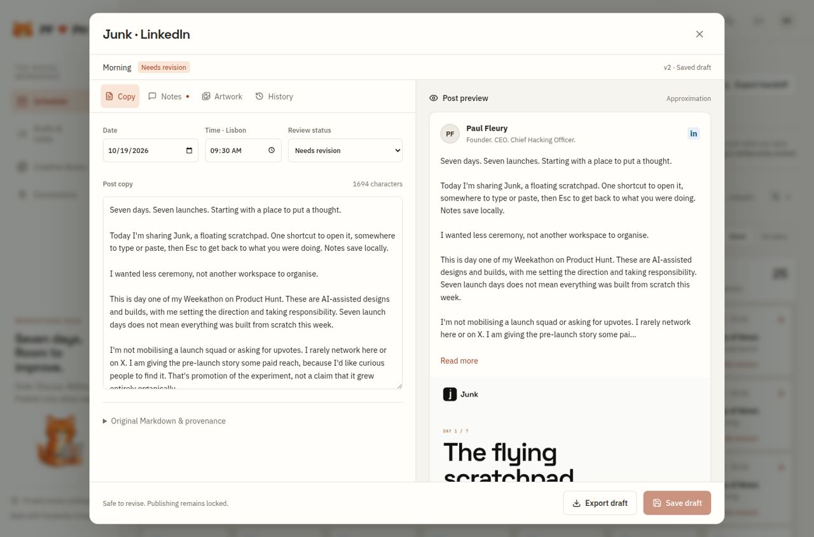

# PH Social Manager

PH Social Manager is the small campaign tool I used to plan and keep track of every post in The Product Hunt Marathon (10 to 21 November 2026). Every post on Product Hunt, X and LinkedIn was published by hand, and this app was where the copy was drafted, reviewed and checked, and where each live link was logged afterwards.

This folder is a cleaned, code-only snapshot. It is published so that you can read how it works and adapt it, not so that you can run my campaign.

<table>
  <tr>
    <td width="50%"></td>
    <td width="50%"></td>
  </tr>
  <tr>
    <td align="center">The weekly schedule</td>
    <td align="center">The editor</td>
  </tr>
</table>

## What it does

- A weekly calendar of Product Hunt, X and LinkedIn slots.
- An editor for each post with its copy, your notes, artwork and a history of earlier versions.
- Previews that approximate how a post will look on each platform. They are approximate, not pixel-exact.
- Readiness validation: unresolved warnings block a post from being marked Ready.
- Posted receipts, recorded manually with the real URL once the post is live.
- A Markdown handoff export.
- Numbered comment threads for follow-ups, in `shared/followup.ts`.

It cannot publish or schedule anything. That was a choice: I posted by hand, and the app exists to make that calm and checkable.

## What was removed

This snapshot contains no real campaign data, no private assets, no internal notes and no deployment scripts. A small example campaign is included so you can run it. Only seven generic tests remain. You will need to bring your own campaign content. The shape it must take is described in the data model below.

## Stack

- **Client:** React, Vite and TypeScript. The entry point is `client/main.tsx`. `PostPreview.tsx` draws the platform-style previews and `phKit.ts` holds Product Hunt launch helpers.
- **Server:** Express. `server/app.ts` is the API, `dev.ts` and `production.ts` are the entry points, and `fly-store.ts` is a SQLite store designed to sit on a Fly.io volume. `migration.sql` holds legacy Supabase policies from an earlier version of the storage.
- **Shared:** `shared/schema.ts` (types and validation with Zod), `rules.ts` (copy rules and validation), `followup.ts` (numbered comment threads) and `media.ts`.

```
social-manager/
├── client/
│   ├── main.tsx
│   ├── PostPreview.tsx
│   └── phKit.ts
├── server/
│   ├── app.ts
│   ├── dev.ts
│   ├── production.ts
│   ├── fly-store.ts
│   └── migration.sql
└── shared/
    ├── schema.ts
    ├── rules.ts
    ├── followup.ts
    └── media.ts
```

## Data model

Everything the client and server agree on is defined once in `shared/schema.ts`, with Zod, and the TypeScript types are derived from it.

**Campaign** is the top-level object: a list of `posts`, a list of `assets`, a `revision` number and an `updatedAt` timestamp.

**Post** is one slot in the plan. The fields that matter:

| Field | Meaning |
| --- | --- |
| `id`, `project`, `projectSlug` | Identity, and which tool the post belongs to |
| `platform` | One of `linkedin`, `twitter`, `producthunt`, `announcement` |
| `title`, `source`, `sourceMarkdown` | A label, and where the copy came from |
| `date`, `time`, `scheduledAt`, `timezone` | When it is planned. The timezone is fixed to `Europe/Lisbon` |
| `content` | An array of 1 to 30 strings, each up to 20,000 characters. More than one entry means a thread or numbered parts |
| `notes` | Private notes, up to 50,000 characters |
| `status` | `draft`, `revision`, `copy-approved`, `ready`, `skipped` or `published-manually` |
| `optional` | Whether the slot can be dropped without breaking the plan |
| `media` | Names of the artwork attached |
| `version`, `updatedAt`, `validatedAt` | Bookkeeping |
| `publication` | The receipt, described below |
| `history` | Earlier snapshots of copy, notes, date, time, status, media and receipt |

A **publication** receipt has a `source` (`manual` or `blotato`), a `state` (`linked`, `in-progress`, `scheduled`, `published` or `failed`) and optional fields for identifiers, the live `url`, `confirmedAt`, `checkedAt`, `scheduledTime` and an `error` message. In practice the receipt was the real URL, recorded by hand. The `blotato` source value is a leftover from a scheduling service and nothing in this snapshot publishes or schedules.

A **patch** is what the editor sends when you save. It carries the `version` the edit started from, plus `content`, `notes`, `status`, `date` (as `YYYY-MM-DD`), `time` (as `HH:MM`) and up to ten `media` entries. Carrying the version is the hook you would use to notice an edit made against a stale copy.

An **asset** describes an image: `id`, `project`, `channel`, `name`, `file`, `width`, `height`, `alt` and an optional `revision`.

A **preview profile** holds the name, headline, X handle and an optional avatar (a data URL, capped in size) that the previews show. The default profile in the schema is mine, so change it.

The function `draftIssueMessage` turns Zod validation failures into sentences a person can act on. It names the field ("Post copy", "Your notes", "Date"), says which part of a multi-part post is at fault, and gives the length against the limit. It reports the first three issues and counts the rest.

## Security model

This is a single-owner tool, and the security is built around that.

- Owner-only password sign-in.
- Passwords are stored as salted scrypt hashes.
- Sessions are kept on the server.
- Cookies are `Secure` and `HttpOnly`.
- The password is set once, through a one-time setup step, and not shipped in the code.

There is no multi-user model, roles or sharing. If you need those, treat this as a starting point and not a finished design. Review the code before you put anything private behind it.

## Local setup

You need a current Node.js and npm.

```sh
cd social-manager
npm install
npm run dev
```

The scripts:

| Command | What it does |
| --- | --- |
| `npm run dev` | Starts the server with `tsx watch server/dev.ts` |
| `npm run build` | Builds the client with Vite |
| `npm run check` | Type-checks with `tsc` |
| `npm test` | Runs the seven generic tests with `tsx --test` |

### Try it with the example campaign

`examples/campaign.example.json` is a small, made-up campaign (a Product Hunt launch, an X thread, a LinkedIn post and a results post) in the exact shape the app expects. It's seeded into SQLite on first start.

```sh
mkdir -p data && cp examples/campaign.example.json data/campaign.json
APP_URL=http://localhost:3100 STORAGE_MODE=fly DB_PATH=./local/data.db \
  BOOTSTRAP_TOKEN=pick-a-long-random-string npm run dev
```

Then set the owner password once, and sign in at http://localhost:3100:

```sh
curl -X POST http://localhost:3100/api/bootstrap \
  -H 'Origin: http://localhost:3100' -H 'Content-Type: application/json' \
  -H 'x-bootstrap-token: pick-a-long-random-string' \
  -d '{"email":"owner@example.com","password":"at-least-16-characters"}'
```

| Variable | What it does |
| --- | --- |
| `STORAGE_MODE=fly` | Uses the SQLite store in `server/fly-store.ts` (the mode I ran in production) |
| `DB_PATH` | Where the SQLite file lives. Defaults to `/data/data.db`, a Fly.io volume |
| `APP_URL` | The origin allowed to send writes. `APP_ALT_ORIGINS` adds more, comma-separated |
| `BOOTSTRAP_TOKEN` | One-time secret for setting the owner password. Remove it afterwards |
| `BOOTSTRAP_EXPIRES` | Optional epoch milliseconds after which the setup link stops working |

Artwork goes in `private-assets/` and is listed in the campaign's `assets` array. To start your own campaign, replace `data/campaign.json` before the first run, or delete the SQLite file to reseed. Every save bumps `revision`, and a save against a stale revision is refused.

## Owner email placeholder locations

The owner email in this snapshot is a placeholder on the `example.com` domain. Replace it with your own in all four places before running anything real:

1. `server/app.ts`
2. `server/fly-store.ts`
3. `server/migration.sql`
4. `client/main.tsx`

Search the folder for `example.com` to check you have found them all.

## Publication boundaries

The app plans, checks and records. It does not post. It has no connection to X, LinkedIn or Product Hunt that publishes on your behalf. When a post is live, you paste the real URL into a receipt, and the status moves to `published-manually`. Product Hunt is a trademark of its owner, and this project is not affiliated with or endorsed by Product Hunt.

That boundary kept the process honest for me. Nothing could go out because a slot was due. A person had to decide.

## Ideas to adapt it for your own campaign

- **Change the platforms.** `platformSchema` is a short enum. Swap in the channels you use, then follow the compiler errors through the previews and rules.
- **Change the timezone.** It is a fixed literal, `Europe/Lisbon`. Set it to yours, or make it a field on the campaign.
- **Write your own copy rules.** `shared/rules.ts` is where readiness is decided. Encode what matters to your campaign, such as length, required links or banned phrases, so that warnings block Ready.
- **Keep the receipts.** Recording the real URL after each post makes it simple to build a report later.
- **Use the handoff export.** The Markdown export is a handy way to give a collaborator, or yourself on launch morning, a clean copy of what is about to go out.
- **Keep versions.** Post history makes it easy to see what changed when a date moved or a draft was reworked.
- **Replace the profile.** Put your own name, headline and handle into the preview profile.

## Licence

Code is MIT, see the `LICENSE` file at the repository root. Written content, photos, illustrations and audio elsewhere in the repository are (c) Paul Fleury, all rights reserved unless stated. For questions, use [paulfleury.com/contact](https://paulfleury.com/contact).
