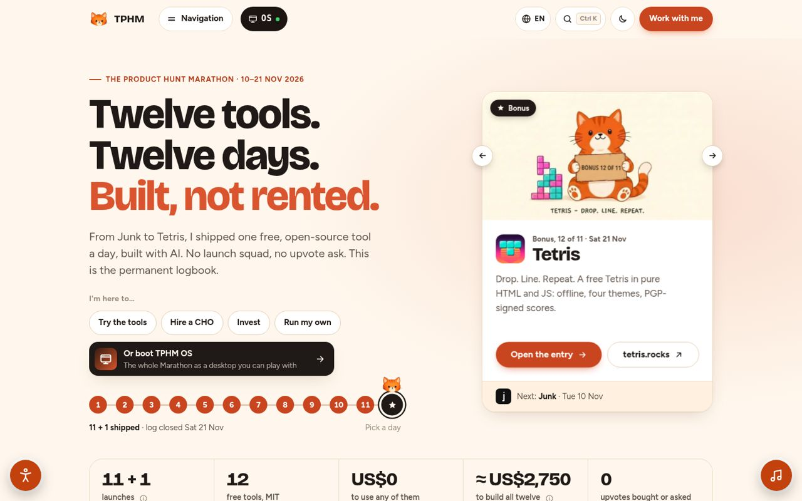
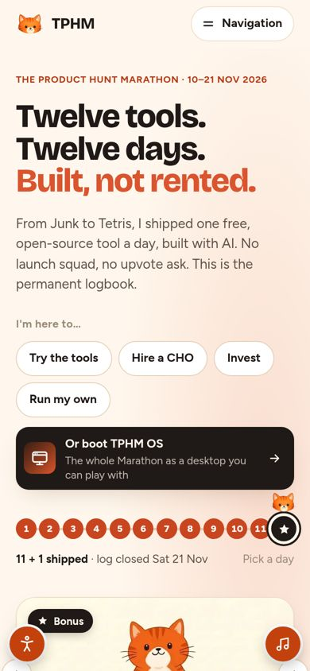

# tphm.io

This folder is the source of [tphm.io](https://tphm.io), the permanent logbook of The Product Hunt Marathon. It is a static site written in plain HTML, CSS and vanilla JavaScript. There is no framework and no bundler, and Python scripts do the build.

The Marathon ran from 10 to 21 November 2026: one free, open-source (MIT) tool a day, built with AI, eleven launches plus a bonus (Tetris), each launched manually on Product Hunt. This site records what happened, what each tool is, and what I would tell someone planning their own run.

<table>
  <tr>
    <td width="70%"></td>
    <td width="30%"></td>
  </tr>
  <tr>
    <td align="center">Desktop home page</td>
    <td align="center">Mobile, 390 px wide</td>
  </tr>
</table>

## What is in this folder

```
tphm.io/
├── src/
│   ├── index.html        Logbook template: the home page, the chapters
│   │                     (sections marked data-page) and the dialogs (data-k)
│   ├── os.html           Template for TPHM OS
│   └── simple.json       Source text for the plain-language page
├── tools/
│   ├── build.py          Writes one static HTML file per page and language
│   ├── harvest.py        Collects every English string into keys.json
│   ├── translate.py      Translates keys.json into fr, cmn and he
│   ├── simple.py         Builds simple/index.html from src/simple.json
│   ├── simple_voice.py   Records the narration for the simple page
│   ├── og.py             Makes the 1200x630 Open Graph cards
│   └── serve.py          Local server that mimics the .htaccess clean URLs
├── app.js                Logbook behaviour: navigation, dialogs, tooltips,
│                         search, theme, lessons checklist, launch kit
├── assets/
│   ├── data.js           window.TPHM_LOG, the twelve entries
│   ├── i18n/
│   │   ├── i18n.js       Runtime translation layer
│   │   ├── keys.json     Every English string (generated by harvest.py)
│   │   └── <code>.json   Cached translations per language
│   └── og/               One Open Graph card per product, e.g. junk.jpg
├── os/                   TPHM OS: os.js and os.css
├── ph.css                Shared design system, inherited from ph.paulfleury.com
├── tphm.css              Additions specific to this site
└── .htaccess             Clean URLs and cache headers
```

The `simple/` folder, with `index.html` and `voice-en.mp3`, is produced by `tools/simple.py` and `tools/simple_voice.py`. The built pages such as `hunt/index.html` are produced by `tools/build.py`.

The pages are:

| Path | What it is |
| --- | --- |
| `/hunt` | Field notes from Product Hunt |
| `/saas` | SaaS is dead |
| `/cho` | Chief Hacking Officer |
| `/invest` | Investing notes |
| `/builders` | Six lessons and a launch-day checklist |
| `/simple` | The same story in plain words, with narration |
| `/os` | TPHM OS |
| `/<repo>` | One page per tool, for example `/junk` |

Tetris is the bonus and has no page here. It lives at [tetris.rocks](https://tetris.rocks).

## Build commands

You need Python 3. The harvest step also needs Playwright.

Serve the site locally:

```sh
cd tphm.io
python3 tools/serve.py 8931
```

Then open http://127.0.0.1:8931. `serve.py` copies the behaviour of `.htaccess`, so `/hunt` resolves to `hunt/index.html` just as it does on the live host.

Rebuild the pages and the simple page:

```sh
python3 tools/build.py && python3 tools/simple.py
```

`build.py` produces 72 pages: English, French, Mandarin (`cmn`) and Hebrew. Each page has its own URL, title, description, canonical link, hreflang tags and Open Graph metadata. A `VER` constant inside the script is the cache-busting version. Change it when you ship changed CSS or JavaScript so that browsers fetch the new files.

The `--prerender` flag bakes the translations into the HTML at build time. Without it, translation happens in the browser through `assets/i18n/i18n.js`.

```sh
python3 tools/build.py --prerender
```

I am deliberately not listing options for the other scripts. Read the top of each file for what it expects, especially `translate.py`, which calls OpenRouter and so needs your own API access.

## The i18n pipeline

Translations are generated and cached, not hand-maintained. The pipeline has four steps:

1. **Harvest.** `tools/harvest.py` opens every page with Playwright and clicks through the interactive states (dialogs, tabs, tooltips), so that strings which only appear after a click are caught. Every English string goes into `assets/i18n/keys.json`.
2. **Translate.** `tools/translate.py` sends `keys.json` through OpenRouter. A writer model (`anthropic/claude-sonnet-5.5`) produces the translation and a separate reviewer model (`google/gemini-3.8-flash`) checks it. Results are cached per language in `assets/i18n/<code>.json`.
3. **Build.** `tools/build.py` writes the per-language pages. With `--prerender`, the cached translations are baked into the HTML.
4. **Runtime.** `assets/i18n/i18n.js` applies translations in the browser.

Why two models: one that writes and a different one that reviews catches more than one model checking itself. Why harvest by clicking: a text scraper only sees what is in the markup on load, and a logbook full of dialogs hides much of its copy until someone opens them. The cache means that a rerun only needs to translate what is new.

A human read is still worth doing, particularly for Hebrew, which reads right to left.

## TPHM OS

`/os` is a fullscreen retro desktop: a dock, windows, a Finder, Notes (holding the Product Hunt field notes), a Terminal, a Trash and Tetris. The template is `src/os.html`, and the behaviour and styling are in `os/os.js` and `os/os.css`. It is a playful way into the same material as the logbook, and it is built from the same plain files, so you can open `os/os.js` and read it top to bottom.

## The simple page

`/simple` tells the story in plain words, with narration.

- The text lives in `src/simple.json`. Edit it there, not in the generated HTML.
- `python3 tools/simple.py` writes `simple/index.html` from it.
- `tools/simple_voice.py` records the narration with `google/gemini-3.8-flash-tts` (voice Achird) into `simple/voice-en.mp3`. The player plays it at 1.1x.

This page is part of the accessibility work, alongside reading aids, reduced motion and readable contrast.

## Deployment notes

The site is deployed by FTP over TLS to shared hosting. Credentials are never in the repository, and you should keep it that way. Because the output is plain files, any client that speaks FTP over TLS will do.

- Run the build first, then upload the changed files.
- `.htaccess` provides the clean URLs and cache headers, so it must be uploaded too. Without it `/hunt` will not resolve.
- Bump `VER` in `tools/build.py` when CSS or JavaScript changes, otherwise visitors may see stale assets.

The host is Apache-style. If you move to another server, translate the rules in `.htaccess` for it.

## How to add a chapter

A chapter is a `data-page` section in `src/index.html`.

1. Add a new section to `src/index.html` with a `data-page` value that matches the path you want, for example `data-page="notes"` for `/notes`. Copy an existing chapter such as `/saas` as your starting point so the markup and classes match.
2. Make the page reachable. Check how navigation is wired in `app.js` and in the template, and add the new chapter alongside the existing ones.
3. Register the page in `tools/build.py` so it is written out for every language. Look at how the existing chapters are listed and follow the same pattern.
4. Run `python3 tools/build.py` and open the page through `tools/serve.py`.
5. Run `tools/harvest.py` and then `tools/translate.py` so the new strings get French, Mandarin and Hebrew versions, then rebuild with `--prerender`.
6. Read the page on a narrow screen. The mobile screenshot above is 390 px wide for a reason.

## How to add a tool

The twelve entries live in `assets/data.js` as `window.TPHM_LOG`. Each entry has these fields: `n`, `day`, `name`, `key`, `kind`, `line`, `note`, `stack`, `budget`, `site`, `gh` and `ph`.

1. Add an entry to `window.TPHM_LOG` with all of those fields. Use an existing entry as the model for the format of each value.
2. Add its dialog section (marked `data-k`) to `src/index.html`, matching the `key` you chose.
3. Make its Open Graph card with `tools/og.py`, which produces a 1200x630 image per product with its Marathon kitty. The cards sit in `assets/og/`, named after the repo, for example `assets/og/junk.jpg`.
4. Rebuild with `python3 tools/build.py`. Each tool gets a page at `/<repo>`.
5. Harvest and translate the new strings, then rebuild with `--prerender`.

If the tool has no website, leave the site field empty as the AI Credit Checker and Mars entries do, and check the page copes with that.

## How to add a language

1. Choose a code. The existing ones are `en`, `fr`, `cmn` and `he`.
2. Add the code to the language list in `tools/build.py` and to the translation targets in `tools/translate.py`, so that pages and translations are produced for it.
3. Run `python3 tools/translate.py`. It writes the cache to `assets/i18n/<code>.json`. Read the result, because a reviewer model is a help and not a native speaker.
4. Make the runtime layer aware of it by checking `assets/i18n/i18n.js` and whatever language switcher the template uses.
5. Rebuild with `python3 tools/build.py --prerender`. Each page should now have a URL, canonical link and hreflang entry for the new language.
6. If the language is written right to left, look at how Hebrew is handled and do the same.
7. Open the pages and check the narrow layout, because translated text is often longer than English.

## Licence and attribution

Code is MIT, see the `LICENSE` file at the repository root. Written content, photos, the kitty illustrations and the narration audio are (c) Paul Fleury, all rights reserved unless stated. Product names belong to their owners. Product Hunt is a trademark of its owner, and this project is not affiliated with or endorsed by Product Hunt.

To get in touch, use [paulfleury.com/contact](https://paulfleury.com/contact).
